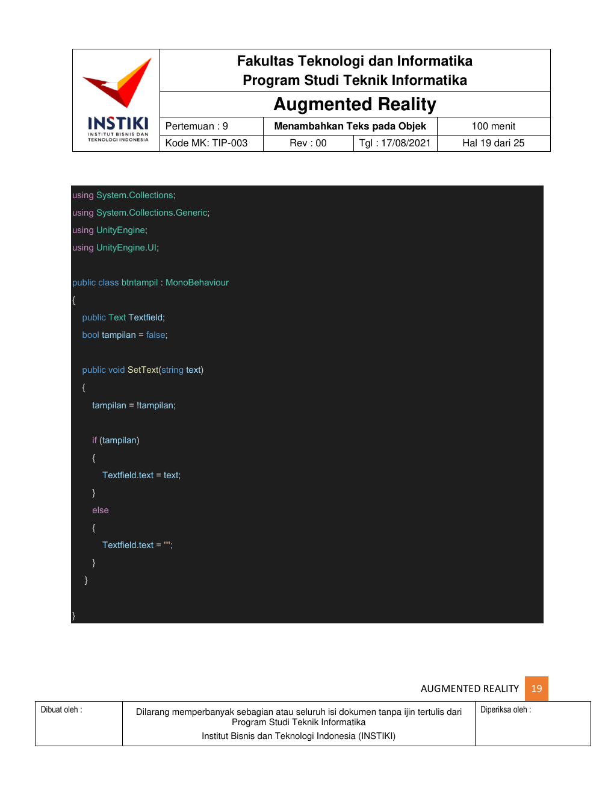

# Tutorial UTS Augmented Reality (Unity 6000)

Dokumen ini adalah tutorial lengkap untuk mengerjakan UTS Augmented Reality berdasarkan gambar requirement dan modul praktikum:

- **Modul 4** — Membuat marker, license, dan database Vuforia.
- **Modul 5** — Tools Unity, menambahkan objek 3D/FBX, material/tekstur, dan build APK.
- **Modul 6** — Rotasi dan zoom/scale objek dengan Lean Touch dan slider.
- **Modul 9** — Menambahkan teks/informasi dan tombol pada objek AR.
- **Modul 11** — Mengarahkan tombol menu ke scene AR.

Proyek ini sudah disiapkan untuk **Unity 6000.0.34f1**. Jangan membuka proyek dengan Unity 2021/2022 karena script memakai API Unity 6 seperti `FindObjectsByType`, `FindFirstObjectByType`, dan font bawaan `LegacyRuntime.ttf`.

> **Ingin membuat dari nol tanpa template?** Ikuti [README_TANPA_TEMPLATE.md](README_TANPA_TEMPLATE.md). Dokumen tersebut membuat proyek Unity baru dari kosong, tanpa generator atau script template.

---

## 0. Requirement UTS dan pemetaan modul

Berdasarkan gambar UTS:

**Nilai B**
1. Buat Menu utama (desain bebas berisi 1 tombol untuk AR kamera).
2. AR kamera dapat menampilkan objek 3D.

**Nilai A**
1. Buat Menu utama (desain bebas berisi 1 tombol untuk AR kamera).
2. AR kamera dapat menampilkan objek 3D.
3. Menambahkan salah satu zoom / rotasi.

Pemetaan ke modul dan tutorial:

| Requirement UTS | Nilai | Modul | Bagian tutorial |
|---|---|---|---|
| Menu utama dengan 1 tombol ke AR kamera | B no.1 / A no.1 | Modul 11 | Langkah 1 |
| AR kamera menampilkan objek 3D | B no.2 / A no.2 | Modul 4 dan 5 | Langkah 2 |
| Zoom atau rotasi objek | A no.3 | Modul 6 | Langkah 3 |
| Teks/informasi pada objek | Nilai tambah | Modul 9 | Bagian 7 (opsional) |
| Build APK Android | Syarat demo | Modul 5 | Bagian 6 |

Dengan kata lain:

- **Nilai B** = Langkah 1 + Langkah 2.
- **Nilai A** = Langkah 1 + Langkah 2 + Langkah 3.

Template ini sudah menyiapkan **zoom dan rotasi sekaligus**, jadi aman untuk Nilai A.

---

## 1. Aset dari dosen dan isi proyek

### 1.1 Aset yang disediakan dosen

Gambar UTS mencantumkan:

1. **Desain 3D** — model 3D yang akan ditampilkan di atas marker.
2. **Database Marker** — file database Vuforia, biasanya berupa `.dat` + `.xml` atau `.unitypackage`.
3. **License** — Vuforia App License Key.

Ketiganya berasal dari dosen. Di mesin lokal, proyek ini membawa **salinan** license dan dataset dari proyek `DataRafi_new` sebagai contoh. Namun, file license **tidak disimpan di repositori** karena berisi kunci rahasia; setelah clone, tambahkan license dari dosen.

- License lokal: `Assets/Resources/VuforiaConfiguration.asset`
- Dataset: `Assets/StreamingAssets/Vuforia/DataRafi.dat` dan `DataRafi.xml`
- Target contoh: `cover-sui`
- Objek 3D contoh: kubus `Konten3D` (placeholder)

Jika aset dari dosen berbeda, ganti license, dataset, target, dan model sesuai Langkah 2.

### 1.2 Isi proyek

```text
UTS_AR_Template/
├── Assets/
│   ├── UTS_Template/
│   │   ├── Editor/UTSTemplateBuilder.cs
│   │   ├── Scripts/MainMenuController.cs
│   │   ├── Scripts/ARInteractionController.cs
│   │   └── README.md
│   ├── Resources/VuforiaConfiguration.asset
│   ├── StreamingAssets/Vuforia/DataRafi.dat
│   └── StreamingAssets/Vuforia/DataRafi.xml
├── Packages/
│   ├── manifest.json
│   └── com.ptc.vuforia.engine-11.4.4.tgz
├── ProjectSettings/
├── README.md
└── README_TANPA_TEMPLATE.md
```

Panduan teknis template (script, generator, struktur scene) ada di `Assets/UTS_Template/README.md`.

### 1.3 Dua jalur pengerjaan

Tutorial ini menyediakan dua jalur. Pilih salah satu, tidak perlu keduanya.

**Jalur A — memakai template (cepat)**

- Jalankan generator scene.
- Ganti kubus dengan model dari dosen.
- Gunakan rotasi/zoom bawaan template.
- Cocok jika ingin cepat selesai dan tetap mengikuti requirement.

**Jalur B — mengikuti modul dari nol (manual)**

- Buat scene menu dan AR sendiri.
- Buat marker/license sendiri atau impor dari dosen.
- Tambahkan 3D object, Lean Touch/slider, dan tombol scene.
- Cocok jika ingin memahami materi Modul 4, 5, 6, dan 11 secara langsung.

Keduanya memenuhi requirement UTS. Bagian tutorial akan menandai langkah mana yang termasuk Jalur A dan Jalur B.

Untuk panduan terpisah yang benar-benar membuat **proyek Unity baru dari nol** (tanpa folder template), lihat [README_TANPA_TEMPLATE.md](README_TANPA_TEMPLATE.md).

---

## 2. Persiapan

### 2.1 Perangkat lunak

- Unity **6000.0.34f1** atau Unity 6 lain yang kompatibel.
- Vuforia Engine **11.4.4** (sudah ada di `Packages/`).
- Input System 1.12 (sudah ada di manifest).
- Android Build Support, Android SDK, dan JDK melalui Unity Hub jika ingin build APK.
- Webcam laptop untuk uji di Editor, atau HP Android untuk uji build.

### 2.2 Perangkat keras dan bahan

- Marker dari dosen, dicetak atau ditampilkan di layar lain.
- Model 3D dari dosen (FBX/OBJ/GLB).
- HP Android dengan kamera.
- Ruang disk yang cukup.

### 2.3 Ruang disk

Proyek ini sengaja ringan, tetapi Unity akan membuat folder `Library` baru saat pertama kali dibuka. Sisakan beberapa GB ruang kosong, atau pindahkan proyek ke drive/mesin yang ruangnya cukup.

### 2.4 Membuka proyek

1. Buka Unity Hub.
2. Tambahkan folder `UTS_AR_Template`.
3. Buka dengan Unity 6.
4. Tunggu import dan kompilasi selesai.
5. Pastikan Console tidak memiliki error sebelum menjalankan generator.

---

## 3. LANGKAH 1 — Menu utama dengan tombol ke AR kamera

**Requirement:** Nilai B no.1 dan Nilai A no.1.
**Modul terkait:** Modul 11 (Mengarahkan Button ke Scene Lain), dengan desain bebas.

Tujuan langkah ini:

- Ada scene menu.
- Menu memiliki desain (background, judul, tombol).
- Ada **1 tombol** yang membuka scene AR kamera.

### 3.1 Jalur A — memakai template

1. Buka proyek `UTS_AR_Template` di Unity 6.
2. Jalankan menu:

```text
UTS AR > Build Template Scenes
```

3. Generator akan membuat:
   - `Assets/UTS_Template/Scenes/MainMenu.unity`
   - `Assets/UTS_Template/Scenes/ARScene.unity`
   - material `Konten3D.mat`
   - mendaftarkan kedua scene ke Build Settings
   - membuka `MainMenu.unity`
4. Pada scene `MainMenu`, lihat Hierarchy:

```text
Canvas
└── KartuMenu
    ├── JudulUtama
    ├── SubJudul
    ├── InfoMahasiswa
    ├── TombolMulaiAR
    └── TombolKeluar
MainMenuController
EventSystem
Main Camera
```

5. Klik `TombolMulaiAR`; pada komponen `Button`, OnClick memang kosong karena listener dipasang oleh `MainMenuController` saat runtime.
6. Klik `MainMenuController`; field `Start Button` dan `Quit Button` sudah terisi.
7. Ganti teks `InfoMahasiswa` dengan nama, NIM, kelas, dan mata kuliah Anda.
8. Ganti `JudulUtama` jika ingin judul lain.
9. Tekan Play; klik **MULAI AR**.

`MainMenuController` akan memanggil:

```csharp
SceneManager.LoadScene("ARScene");
```

Jika scene AR belum terdaftar di Build Settings, Console akan menampilkan error. Jalankan generator atau tambahkan scene secara manual.

### 3.2 Jalur B — mengikuti Modul 11 secara manual

#### 3.2.1 Siapkan dua scene

1. Buat scene menu: **File > New Scene**, simpan sebagai:

```text
Assets/UTS_Template/Scenes/MainMenu.unity
```

2. Buat scene AR nanti di Langkah 2, simpan sebagai:

```text
Assets/UTS_Template/Scenes/ARScene.unity
```

Jika folder `Assets/UTS_Template/Scenes` belum ada, buat folder tersebut terlebih dahulu di Project window.

Modul 11 menyebut dua scene: **Scene Scan Augmented Reality** dan **Scene Menu**. Di tutorial ini namanya `ARScene` dan `MainMenu`.

#### 3.2.2 Buat Canvas menu

1. Klik kanan Hierarchy > **UI > Canvas**.
2. Pada `Canvas Scaler`:
   - UI Scale Mode: `Scale With Screen Size`
   - Reference Resolution: `1080 x 1920` (portrait) atau `1280 x 720` (landscape, seperti contoh Modul 6)
   - Match: `0.5`
3. Pastikan ada `EventSystem` di Hierarchy. Unity biasanya membuatnya otomatis.
4. Pada `EventSystem`, gunakan `InputSystemUIInputModule` karena proyek ini memakai Input System baru. Jika memakai Input Manager lama, gunakan `StandaloneInputModule`.

#### 3.2.3 Desain bebas

Buat desain menu sesuka Anda. Contoh komposisi minimal:

1. **Background**: klik kanan Canvas > UI > Image; beri nama `Background`; atur warna gelap; klik `Rect Transform` > Anchor Presets > stretch (kiri-kanan-atas-bawah).
2. **Judul**: klik kanan Canvas > **UI > Legacy > Text**; beri nama `Judul`; isi teks `AR UTS`; atur font size, warna, dan posisi.
3. **Subjudul**: **UI > Legacy > Text**; isi `Marker-Based Augmented Reality`.
4. **Identitas**: **UI > Legacy > Text**; isi nama, NIM, kelas, dan mata kuliah.
5. **Tombol**: klik kanan Canvas > **UI > Button**; beri nama `TombolMulaiAR`; ubah teks anaknya menjadi `MULAI AR`; atur warna, ukuran, dan posisi.

Catatan Unity 6: teks UGUI legacy berada di **UI > Legacy > Text**. Varian TextMeshPro berada di **UI > Text - TextMeshPro** dan tidak kompatibel langsung dengan script yang memakai tipe `Text` legacy. Template ini memakai teks legacy agar konsisten dengan modul.

Requirement hanya meminta **1 tombol untuk AR kamera**. Tombol tambahan seperti `KELUAR` boleh, tetapi jangan sampai mengaburkan tombol utama.

#### 3.2.4 Script pindah scene

Buat script C# baru di `Assets/UTS_Template/Scripts/`:

```text
Klik kanan Project > Create > C# Script
Nama: PindahScene
```

Isi script:

```csharp
using UnityEngine;
using UnityEngine.SceneManagement;

public class PindahScene : MonoBehaviour
{
    public void PindahKeScene(string namaScene)
    {
        SceneManager.LoadScene(namaScene);
    }
}
```

Penjelasan:

- `SceneManager.LoadScene(namaScene)` membuka scene berdasarkan nama.
- Parameter `string namaScene` membuat kolom nama scene muncul di OnClick Button.
- Modul 11 menggunakan nama scene `PikaAR`; di tutorial ini nama scene-nya `ARScene`.

#### 3.2.5 Hubungkan tombol ke script

1. Pilih `TombolMulaiAR`.
2. Pada komponen `Button`, cari **On Click ()**.
3. Klik tanda **+**.
4. Seret GameObject `TombolMulaiAR` ke kolom objek.
5. Pada dropdown fungsi, pilih:

```text
PindahScene > PindahKeScene (string)
```

6. Pada kolom parameter, ketik:

```text
ARScene
```

7. Simpan scene: **File > Save**.

Jika memakai Input System baru dan tombol tidak bisa diklik, pastikan `EventSystem` memakai `InputSystemUIInputModule`.

#### 3.2.6 Daftarkan scene ke Build Settings

1. Buka **File > Build Profiles** (Unity 6) atau **File > Build Settings**.
2. Pada **Scenes in Build**, klik **Add Open Scenes**.
3. Pastikan urutannya:

```text
0: Assets/UTS_Template/Scenes/MainMenu.unity
1: Assets/UTS_Template/Scenes/ARScene.unity
```

Scene `ARScene` baru dibuat di Langkah 2. Tambahkan setelah scene tersebut ada.

#### 3.2.7 Uji tombol

1. Tekan Play di scene `MainMenu`.
2. Klik **MULAI AR**.
3. Jika `ARScene` belum ada atau belum terdaftar, Unity akan menampilkan error. Buat scene AR di Langkah 2 dan ulangi Build Settings.

### 3.3 Kesalahan umum Langkah 1

| Gejala | Penyebab | Solusi |
|---|---|---|
| Tombol tidak bereaksi | OnClick belum diisi | Isi OnClick dengan `PindahScene.PindahKeScene` |
| Tombol tidak bisa diklik | EventSystem hilang / input module salah | Tambahkan EventSystem + InputSystemUIInputModule |
| `Scene 'ARScene' could not be loaded` | Scene belum ada atau belum di Build Settings | Buat scene AR dan tambahkan ke Build Settings |
| Script error | Nama file/class tidak sama | Nama file `PindahScene.cs`, class `PindahScene` |
| Menu tidak tampil | Canvas/EventSystem belum dibuat | Buat Canvas dan EventSystem |

---

## 4. LANGKAH 2 — AR kamera menampilkan objek 3D

**Requirement:** Nilai B no.2 dan Nilai A no.2.
**Modul terkait:** Modul 4 (marker/license/database) dan Modul 5 (objek 3D, material, build).

Tujuan langkah ini:

- Ada scene AR dengan AR Camera Vuforia.
- Ada Image Target yang memakai database dari dosen.
- Ada objek 3D sebagai child Image Target.
- Saat marker dipindai, objek 3D muncul di atas marker.

### 4.1 Database marker dan license (Modul 4)

#### 4.1.1 Jika aset diberikan dosen

Ini jalur yang diminta pada gambar UTS.

1. Jika dosen memberi file `.unitypackage`:
   - Buka **Assets > Import Package > Custom Package**.
   - Pilih file dari dosen.
   - Klik **Import**.
   - Biasanya akan muncul database di `Assets/StreamingAssets/Vuforia/` dan prefab Image Target.
2. Jika dosen memberi file `.dat` dan `.xml`:
   - Salin keduanya ke `Assets/StreamingAssets/Vuforia/`.
   - Pastikan nama file dan path sesuai dengan yang diisi di Image Target.
3. Jika dosen memberi license key:
   - Pilih `Assets/Resources/VuforiaConfiguration.asset`.
   - Pada Inspector, tempelkan **App License Key**.
   - Atau buka jendela konfigurasi Vuforia Engine dan tempelkan di sana.
4. Jika dosen memberi target baru:
   - Catat nama target dari file XML.
   - Catat width dan height target.
   - Isi di komponen `Image Target Behaviour`.

Proyek ini sudah memiliki contoh:

```text
Dataset : Vuforia/DataRafi.xml
Target  : cover-sui
Width   : 20
Height  : 31.846153
```

Jika aset dosen berbeda, ganti nilai tersebut.

#### 4.1.2 Jika membuat marker sendiri (opsional, Modul 4)

Lewati bagian ini jika dosen sudah memberi database marker.

1. Buka `https://developer.vuforia.com/`.
2. Register akun dan login.
3. Setujui Vuforia Developer Agreement.
4. Buka **License Manager**.
5. Klik **Get Development Key**.
6. Isi nama license, setujui, lalu klik **Confirm**.
7. Salin **License Key**.
8. Buka **Target Manager**.
9. Klik **Add Database**.
10. Isi nama database, pilih tipe **Device**, lalu klik **Create**.
11. Buka database, klik **Add Target**.
12. Pilih **Single Image**.
13. Upload gambar marker.
14. Isi nama target dan ukuran marker.
15. Klik **Add Target**.
16. Periksa kualitas target (bintang dan fitur). Marker yang baik:
    - kaya detail;
    - kontras terang/gelap bagus;
    - tidak memiliki pola berulang.
17. Klik **Download Database**.
18. Pilih **Unity Editor**, lalu klik **Download**.
19. Simpan file `.unitypackage`.
20. Impor `.unitypackage` ke Unity.
21. Tempelkan License Key ke `VuforiaConfiguration`.

Catatan: tampilan portal Vuforia dapat berubah, tetapi alurnya tetap: License Manager → Target Manager → Download Database → Import ke Unity.

### 4.2 Membuat scene AR dan Image Target

#### 4.2.1 Jalur A — template

Generator dari Langkah 1 sudah membuat `ARScene` berisi:

- `ARCamera` dengan `VuforiaBehaviour`.
- `ImageTarget` dengan `ImageTargetBehaviour`.
- `Konten3D` (kubus contoh).
- `CanvasAR` dengan slider rotasi, tombol zoom, reset, dan kembali.
- `ARController` dengan `ARInteractionController`.
- `Directional Light`.
- `EventSystem`.

Buka `Assets/UTS_Template/Scenes/ARScene.unity`.

#### 4.2.2 Jalur B — manual mengikuti Modul 5

1. Buat scene baru: **File > New Scene**.
2. Simpan sebagai `Assets/UTS_Template/Scenes/ARScene.unity`.
3. Tambahkan AR Camera:
   - **GameObject > Vuforia Engine > AR Camera**.
4. Tambahkan Image Target:
   - **GameObject > Vuforia Engine > Image Target**.
5. Pilih `ImageTarget`.
6. Pada komponen `Image Target Behaviour`:
   - **Database**: pilih database dari dosen (`DataRafi`).
   - **Image Target**: pilih target (`cover-sui` atau nama dari dosen).
   - **Width/Height**: sesuaikan dengan XML/dosen.
7. Atur posisi `ImageTarget` di `(0, 0, 0)`.
8. Tambahkan `Directional Light` jika scene masih gelap:
   - **GameObject > Light > Directional Light**.
   - Rotation: `(50, -30, 0)`.

Catatan: Jangan menaruh objek 3D sebagai root scene. Objek harus menjadi **child dari ImageTarget** agar ikut bergerak mengikuti marker.

### 4.3 Menambahkan objek 3D (Modul 5)

#### 4.3.1 Objek dasar untuk uji cepat

1. Klik kanan `ImageTarget` di Hierarchy.
2. Pilih **3D Object > Cube**.
3. Beri nama `Konten3D`.
4. Pada Inspector:
   - Position: `(0, 4, 0)`
   - Scale: `(8, 8, 8)`
5. Tekan Play dan arahkan marker ke webcam.

Objek dasar ini hanya untuk memastikan AR Camera, marker, dan posisi objek sudah benar. Untuk UTS, ganti dengan model dari dosen.

#### 4.3.2 Memakai model 3D dari dosen

1. Buat folder `Assets/UTS_Template/Models/`.
2. Impor model dari dosen (FBX/OBJ/GLB) ke folder tersebut.
3. Pastikan tekstur/material ikut terimpor.
4. Hapus kubus `Konten3D` yang lama (disarankan). Jika hanya dinonaktifkan, field **Target Model** pada `ARController` harus diisi ulang pada langkah 4.3.3.
5. Buat GameObject kosong sebagai wadah:
   - Klik kanan `ImageTarget` > **Create Empty**.
   - Beri nama `Konten3D`.
6. Seret model dari Project ke dalam `Konten3D`.
7. Atur `Konten3D`:
   - Position: `(0, 0, 0)` dulu.
   - Rotation: `(0, 0, 0)` dulu.
   - Scale: `(1, 1, 1)` dulu.
8. Sesuaikan skala. Target contoh berukuran lebar 20 unit dan tinggi sekitar 31,8 unit. Model dengan tinggi sekitar 10–15 unit biasanya terlihat proporsional.
9. Jika model tidur/miring:
   - Model dengan sumbu Z-up biasanya perlu `Rotation X = -90`.
   - Model dengan sumbu Y-up biasanya tidak perlu rotasi.
10. Jika model tidak berada di tengah, sesuaikan `Position` pada `Konten3D`, bukan pada anak-anaknya.

#### 4.3.3 Menghubungkan model ke template

Jika memakai Jalur A:

1. Pilih `ARController`.
2. Pada komponen `ARInteractionController`, isi field **Target Model** dengan `Konten3D`.
3. Jika field kosong, script akan mencari child bernama `Konten3D` secara otomatis.
4. Rotasi dan zoom akan diterapkan ke `Konten3D`.

Jika memakai Jalur B, objek 3D akan dikendalikan oleh Lean Touch atau slider yang ditambahkan di Langkah 3.

### 4.4 Material dan tekstur (Modul 5)

1. Di Project, klik kanan > **Create > Material**.
2. Beri nama, misalnya `MaterialKonten`.
3. Pada Inspector material, cari **Albedo**.
4. Seret gambar tekstur ke kotak Albedo.
5. Seret material ke objek 3D di Scene/Hierarchy.
6. Jika material terlihat pink:
   - Ganti shader ke `Standard` untuk Built-in Render Pipeline.
   - Atau `Universal Render Pipeline/Lit` jika proyek memakai URP.
7. Jika model FBX sudah membawa material sendiri, pastikan tekstur FBX terhubung dengan benar.

### 4.5 Uji objek 3D

1. Simpan scene.
2. Cetak marker dari dosen, atau tampilkan di layar lain.
3. Tekan Play.
4. Arahkan marker ke webcam.
5. Jika marker terdeteksi, objek 3D akan muncul.
6. Jika tidak muncul:
   - Pastikan objek adalah child `ImageTarget`.
   - Pastikan skala tidak terlalu kecil.
   - Pastikan target/dataset benar.
   - Pastikan marker cukup terang dan tidak blur.
   - Cek status target di Console Vuforia.

Catatan: Vuforia di Editor membutuhkan webcam. Jika laptop tidak punya webcam, build ke HP Android untuk menguji tracking.

### 4.6 Build Settings untuk scene AR

1. Buka **File > Build Profiles** / **Build Settings**.
2. Klik **Add Open Scenes** untuk `ARScene`.
3. Pastikan `MainMenu` berada di index 0 dan `ARScene` di index 1.
4. Scene `ARScene` harus ada di Build Settings agar tombol menu bisa membukanya.

### 4.7 Checklist Langkah 2

- [ ] License Vuforia dari dosen sudah terpasang.
- [ ] Database marker dari dosen sudah diimpor.
- [ ] Scene `ARScene` memiliki AR Camera Vuforia.
- [ ] Image Target memakai database/target yang benar.
- [ ] Objek 3D adalah child dari ImageTarget.
- [ ] Model 3D dari dosen sudah dipasang.
- [ ] Objek muncul saat marker dipindai.
- [ ] `ARScene` terdaftar di Build Settings.

---

## 5. LANGKAH 3 — Menambahkan zoom atau rotasi

**Requirement:** Nilai A no.3.
**Modul terkait:** Modul 6 (Rotasi dan Zoom/Scale Objek).

Pilih salah satu cara. Template sudah menyediakan keduanya, jadi Jalur A paling cepat.

### 5.1 Jalur A — memakai `ARInteractionController` bawaan template

Scene `ARScene` hasil generator sudah memiliki:

- `SliderRotasi` di panel bawah.
- `TeksNilaiRotasi`.
- `TombolZoomIn` (`+`).
- `TombolZoomOut` (`-`).
- `TombolReset`.
- `TombolKembali`.
- `ARInteractionController` pada GameObject `ARController`.

Cara kerja:

- **Rotasi**: slider 0–360 derajat. Script menerapkan offset rotasi pada sumbu Y:

```csharp
targetModel.localRotation = baseRotation * Quaternion.Euler(0f, value, 0f);
```

- **Zoom**: pinch dua jari, scroll mouse di Editor, atau tombol `+`/`-`.
- **Batas zoom**: 25% sampai 400% dari skala awal, dapat diubah di Inspector:

```text
Min Scale Multiplier : 0.25
Max Scale Multiplier : 4
Button Zoom Step     : 1.15
Pinch Sensitivity    : 1
Scroll Zoom Step     : 0.1
```

- **Reset**: mengembalikan posisi, rotasi, dan skala awal.
- **Kembali**: memuat scene `MainMenu`.

Uji di Editor:

1. Tekan Play dari `MainMenu`.
2. Klik **MULAI AR**.
3. Arahkan marker.
4. Geser slider rotasi.
5. Scroll mouse untuk zoom.
6. Klik `+`/`-` untuk zoom.
7. Klik **RESET**.
8. Klik **KEMBALI**.

Uji di HP:

1. Build APK.
2. Buka aplikasi dan izinkan kamera.
3. Arahkan marker.
4. Cubit dua jari untuk zoom.
5. Geser slider untuk rotasi.

Jalur ini sudah memenuhi syarat “salah satu zoom/rotasi”, bahkan keduanya.

### 5.2 Jalur B — manual dengan Lean Touch (Modul 6)

Modul 6 menggunakan Lean Touch untuk scale, rotasi, dan drag.

#### 5.2.1 Impor Lean Touch

Pilihan 1 — dari Asset Store/Package Manager:

1. Buka **Window > Package Manager**.
2. Pilih **My Assets**.
3. Cari **Lean Touch**.
4. Klik **Download** lalu **Import**.
5. Jika muncul dialog import, klik **Import** lagi.

Pilihan 2 — menyalin dari proyek lama:

1. Buka folder `../DataRafi_new/Assets/Plugins/CW`.
2. Salin folder `CW` ke `UTS_AR_Template/Assets/Plugins/CW`.
3. Tunggu Unity selesai import.

Setelah Lean Touch masuk, klik kanan Hierarchy akan muncul menu **Lean**.

#### 5.2.2 Buat Canvas

1. Klik kanan Hierarchy > **UI > Canvas**.
2. Pada `Canvas Scaler`:
   - UI Scale Mode: `Scale With Screen Size`
   - Reference Resolution: `1280 x 720` (seperti Modul 6) atau `1080 x 1920` (portrait)
   - Match: `0.5`

#### 5.2.3 Tambahkan Lean Touch

1. Klik kanan Hierarchy > **Lean > Touch**.
2. Pada Inspector `Lean Touch`, klik **Add Simulator**.
3. Simulator berguna untuk menguji pinch/rotate memakai mouse di Editor.

#### 5.2.4 Tambahkan komponen gesture ke objek 3D

Pilih objek 3D (`Konten3D`), lalu **Add Component**:

1. **Lean Pinch Scale** — untuk zoom/pinch.
2. **Lean Twist Rotate Axis** — untuk rotasi dua jari.
3. **Lean Drag Translate** — untuk menggeser objek.

Atur komponen sesuai kebutuhan. Untuk rotasi, pastikan sumbu rotasi sesuai (misalnya sumbu Y).

#### 5.2.5 Uji

1. Tekan Play.
2. Gunakan simulator Lean Touch di Editor:
   - tahan tombol yang ditentukan untuk pinch/rotate;
   - atau build ke HP dan gunakan dua jari.
3. Pastikan objek berubah skala/rotasi.

Catatan: Lean Touch versi di proyek `DataRafi_new` sudah mendukung Input System baru. Jika versi Lean Touch yang Anda unduh masih memakai Input Manager lama, set **Active Input Handling** ke `Both` di Player Settings.

### 5.3 Jalur C — manual dengan slider (Modul 6)

Modul 6 juga menyediakan cara slider. Ini paling dekat dengan contoh modul.

#### 5.3.1 Slider rotasi

1. Klik kanan Canvas > **UI > Slider**.
2. Rename menjadi `rotateSlider`.
3. Pada komponen `Slider`:
   - Min Value: `0`
   - Max Value: `360`
4. Buat script `rotasi.cs`:

```csharp
using UnityEngine;
using UnityEngine.UI;

public class rotasi : MonoBehaviour
{
    private Slider rotateSlider;
    public float rotMinValue;
    public float rotMaxValue;

    void Start()
    {
        rotateSlider = GameObject.Find("rotateSlider").GetComponent<Slider>();
        rotateSlider.minValue = rotMinValue;
        rotateSlider.maxValue = rotMaxValue;
        rotateSlider.onValueChanged.AddListener(RotateSliderUpdate);
    }

    void RotateSliderUpdate(float value)
    {
        transform.localEulerAngles = new Vector3(
            transform.rotation.x,
            value,
            transform.rotation.z
        );
    }
}
```

5. Tempelkan script `rotasi` ke objek 3D.
6. Pada Inspector, isi:
   - Rot Min Value: `0`
   - Rot Max Value: `360`
7. Tekan Play dan geser slider.

**Perbaikan penting untuk Unity 6:**

Kode modul di atas memakai `transform.rotation.x` dan `transform.rotation.z`. Itu adalah komponen **quaternion**, bukan sudut Euler. Akibatnya rotasi bisa aneh dan orientasi asli model rusak.

Gunakan versi yang benar:

```csharp
void RotateSliderUpdate(float value)
{
    Vector3 euler = transform.localEulerAngles;
    euler.y = value;
    transform.localEulerAngles = euler;
}
```

Atau, agar orientasi awal model tetap:

```csharp
private Quaternion baseRotation;

void Start()
{
    baseRotation = transform.localRotation;
    // ... kode slider ...
}

void RotateSliderUpdate(float value)
{
    transform.localRotation = baseRotation * Quaternion.Euler(0f, value, 0f);
}
```

Template `ARInteractionController` sudah memakai versi offset ini.

#### 5.3.2 Slider scale/zoom

1. Klik kanan Canvas > **UI > Slider**.
2. Rename menjadi `scaleSlider`.
3. Atur Min Value dan Max Value, misalnya:
   - Min Value: `0.5`
   - Max Value: `3`
4. Buat script `scale.cs`:

```csharp
using UnityEngine;
using UnityEngine.UI;

public class scale : MonoBehaviour
{
    private Slider scaleSlider;
    public float scaleMinValue;
    public float scaleMaxValue;

    void Start()
    {
        scaleSlider = GameObject.Find("scaleSlider").GetComponent<Slider>();
        scaleSlider.minValue = scaleMinValue;
        scaleSlider.maxValue = scaleMaxValue;
        scaleSlider.onValueChanged.AddListener(ScaleSliderUpdate);
    }

    void ScaleSliderUpdate(float value)
    {
        transform.localScale = new Vector3(value, value, value);
    }
}
```

5. Tempelkan script `scale` ke objek 3D.
6. Isi Scale Min Value `0.5` dan Scale Max Value `3`.
7. Jangan memakai nilai minimum `0`, karena objek akan menghilang.
8. Jangan memakai nilai maksimum `100`, karena objek menjadi terlalu besar.

Catatan: Jika memakai template, slider bernama `SliderRotasi`, bukan `rotateSlider`. Ganti nama slider atau sesuaikan `GameObject.Find` di script.

### 5.4 Catatan Unity 6 untuk zoom/rotasi

- Gunakan `localEulerAngles` atau rotasi offset, bukan `transform.rotation.x`.
- Pastikan slider berada di Canvas yang aktif.
- `GameObject.Find` hanya menemukan objek aktif.
- Jika UI tidak bisa diklik, pastikan `EventSystem` memakai `InputSystemUIInputModule`.
- Jika memakai Lean Touch lama, set **Active Input Handling** ke `Both`.
- Di Editor, pinch bisa diuji dengan scroll mouse (template) atau simulator Lean Touch.
- Di HP, pinch diuji dengan dua jari.

### 5.5 Checklist Langkah 3

- [ ] Slider rotasi atau zoom sudah ada.
- [ ] Script terpasang pada objek 3D yang benar.
- [ ] Slider mengubah objek saat digeser.
- [ ] Zoom/pinch berfungsi di HP.
- [ ] Tidak ada error `NullReferenceException` di Console.
- [ ] Rotasi tidak merusak orientasi model.

---

## 6. Build APK Android (Modul 5)

### 6.1 Persyaratan build

1. Unity Hub > Installs > pilih Unity 6 > **Add Modules**.
2. Centang **Android Build Support**, **Android SDK & NDK Tools**, dan **OpenJDK**.
3. Tunggu instalasi selesai.

### 6.2 Build Settings

1. Simpan semua scene: **File > Save**.
2. Buka **File > Build Profiles** (Unity 6) atau **File > Build Settings**.
3. Pilih **Android**.
4. Klik **Switch Platform** jika belum Android.
5. Pada **Scenes in Build**, pastikan:

```text
0: Assets/UTS_Template/Scenes/MainMenu.unity
1: Assets/UTS_Template/Scenes/ARScene.unity
```

6. Jika belum ada, klik **Add Open Scenes**.

### 6.3 Player Settings

Buka **Player Settings**:

1. **Company Name**: isi nama Anda.
2. **Product Name**: `UTS AR` (sudah diisi).
3. **Package Name**: misalnya `com.nama.nim.utsar`.
4. **Version**: `1.0` atau sesuai kebutuhan.
5. **Default Icon**: ganti jika ingin ikon sendiri.

Buka **Other Settings**:

1. **Minimum API Level**: Android 7.0 (API 24) atau lebih tinggi.
2. **Target API Level**: Automatic (highest installed).
3. **Scripting Backend**: IL2CPP.
4. **Target Architectures**: ARM64.
5. **Active Input Handling**: Input System Package (New) atau Both.
6. **Internet Access**: Auto.
7. **Camera Usage Description**: isi jika diminta.

### 6.4 Build

1. Klik **Build** atau **Build and Run**.
2. Simpan APK di luar folder `Assets`, misalnya:

```text
Builds/UTS_AR.apk
```

3. Tunggu proses build selesai.
4. Pasang APK di HP Android.
5. Buka aplikasi, izinkan kamera.
6. Arahkan kamera ke marker.
7. Uji menu, objek 3D, dan zoom/rotasi.

### 6.5 Checklist build

- [ ] Android Build Support terpasang.
- [ ] Kedua scene ada di Build Settings.
- [ ] Package Name terisi.
- [ ] Build berhasil tanpa error.
- [ ] APK terpasang di HP.
- [ ] Kamera berfungsi.
- [ ] Marker terdeteksi.
- [ ] Zoom/rotasi berfungsi di HP.

---

## 7. Opsional — menambahkan teks/informasi pada objek (Modul 9)

Bagian ini tidak wajib untuk gambar UTS, tetapi mengikuti Modul 9 dan bisa menjadi nilai tambah.

### 7.1 Teks sederhana pada objek

1. Pastikan marker dan objek 3D sudah ada.
2. Klik kanan Hierarchy > **UI > Canvas**.
3. Klik kanan Canvas > **UI > Image**; beri nama `PanelInfo`; atur ukuran dan warna.
4. Klik kanan `PanelInfo` > **UI > Legacy > Text**; isi teks informasi.
5. Atur font, ukuran, warna, dan alignment.
6. Jika ingin teks muncul mengikuti objek, jangan hanya memindahkan Canvas Screen Space ke dalam objek. Set `Canvas > Render Mode` menjadi `World Space`, atur scale/position, lalu letakkan di dekat objek. Modul 9 memindahkan Canvas ke objek; untuk hasil yang benar di Unity 6, gunakan World Space.
7. Untuk UI screen-space biasa (menu/overlay), biarkan Canvas di root.

### 7.2 Tombol menampilkan teks

1. Klik kanan Canvas > **UI > Button**; beri nama `TombolInfo`.
2. Buat script `btntampil.cs`:

```csharp
using UnityEngine;
using UnityEngine.UI;

public class btntampil : MonoBehaviour
{
    public Text Textfield;
    private bool tampilan = false;

    public void SetText(string text)
    {
        tampilan = !tampilan;
        Textfield.text = tampilan ? text : "";
    }
}
```

3. Tempelkan script ke `TombolInfo`.
4. Isi field `Textfield` dengan objek `Text` yang ingin diubah.
5. Pada `Button > On Click ()`, klik **+**.
6. Seret `TombolInfo` ke kolom objek.
7. Pilih `btntampil > SetText (string)`.
8. Ketik teks informasi pada kolom parameter.
9. Tekan Play dan klik tombol.

Catatan: Modul 9 memakai `UnityEngine.UI.Text`. Di Unity 6, Text UGUI masih tersedia. Jika memakai TextMeshPro, ganti tipe `Text` menjadi `TMP_Text` dan sesuaikan komponennya.

---

<details>
<summary><strong>Lihat screenshot Modul 9 halaman 19 — script btntampil</strong></summary>



*Sumber: Modul 9 halaman 19. Tampilan Unity di modul mungkin versi lebih lama; gunakan sebagai petunjuk letak script dan OnClick.*

</details>

## 8. Pemetaan nilai dan checklist akhir

### 8.1 Nilai B

- [ ] Scene `MainMenu` ada dan bisa dibuka.
- [ ] Menu memiliki desain bebas (background, judul, tombol).
- [ ] Ada **1 tombol** yang membuka scene AR kamera.
- [ ] Scene `ARScene` memiliki AR Camera Vuforia.
- [ ] Marker dari dosen dapat dilacak.
- [ ] Objek 3D dari dosen muncul di atas marker.

### 8.2 Nilai A

- [ ] Semua poin Nilai B terpenuhi.
- [ ] Ada rotasi **atau** zoom.
- [ ] Rotasi/zoom berfungsi di Editor dan di HP.
- [ ] Tidak ada error di Console saat bermain.
- [ ] Build APK berhasil dan diuji di HP.

### 8.3 Checklist sebelum dikumpulkan

- [ ] Desain 3D dari dosen sudah dipakai.
- [ ] Database marker dari dosen sudah dipakai.
- [ ] License dari dosen sudah dipasang.
- [ ] Nama, NIM, kelas, dan mata kuliah ada di menu.
- [ ] Scene `MainMenu` dan `ARScene` ada di Build Settings.
- [ ] APK berhasil di-build.
- [ ] APK diuji di HP Android.
- [ ] Backup proyek disimpan.
- [ ] License key tidak dipublikasikan.

---

## 9. Troubleshooting

| Gejala | Kemungkinan penyebab | Solusi |
|---|---|---|
| Menu `UTS AR` tidak muncul | Script generator belum selesai dikompilasi | Buka Console, tunggu kompilasi, restart Unity |
| Tombol menu tidak bereaksi | OnClick belum diisi | Isi OnClick dengan `PindahScene.PindahKeScene` atau `MainMenuController.StartAR` |
| `Scene 'ARScene' belum terdaftar` | Scene belum ada di Build Settings | Tambahkan `ARScene` ke Build Settings |
| Tombol UI tidak bisa diklik | EventSystem hilang / input module salah | Tambahkan `EventSystem` + `InputSystemUIInputModule` |
| Marker tidak terdeteksi | Dataset/target salah, marker blur, cahaya kurang | Periksa Image Target, cetak marker, tambah cahaya, bersihkan lensa |
| Objek 3D tidak muncul | Objek bukan child ImageTarget, skala terlalu kecil, renderer mati | Parent-kan ke ImageTarget, perbesar skala, cek status target |
| Objek 3D muncul tetapi posisi aneh | Pivot/orientasi model tidak standar | Gunakan wadah `Konten3D`, atur rotasi/posisi wadah |
| Slider tidak mengubah objek | Script belum terpasang / nama slider beda | Tempelkan script ke objek, samakan nama slider |
| Rotasi aneh | Kode modul memakai `transform.rotation.x` | Gunakan `localEulerAngles` atau rotasi offset |
| Zoom menghilangkan objek | Scale minimum 0 | Set minimum misalnya 0.5 |
| Pinch tidak bekerja di Editor | Editor tidak punya layar sentuh | Gunakan scroll mouse atau simulator Lean Touch |
| Lean Touch tidak muncul | Paket belum diimpor | Import dari Package Manager atau salin `Assets/Plugins/CW` |
| Material pink | Shader tidak cocok render pipeline | Ganti ke `Standard` atau `URP/Lit` |
| `NullReferenceException` | Referensi slider/objek kosong | Isi field di Inspector atau samakan nama objek |
| `Vuforia initialization error` | License salah, package name tidak cocok, kamera tidak ada | Periksa license, package name, izin kamera, koneksi internet |
| Build Android gagal | Android Build Support belum terpasang, package name kosong, disk penuh | Pasang Android module, isi package name, kosongkan disk |
| APK crash saat dibuka | License/package name salah, arsitektur tidak cocok | Cek logcat, samakan package name, gunakan ARM64 |
| Scene AR hitam di Editor | Webcam tidak tersedia | Build ke HP Android untuk menguji tracking |
| Preview marker kosong di Scene view | Generator tidak membuat preview editor Vuforia | Abaikan; tracking runtime tetap berjalan |

---

## 10. Catatan penting

### 10.1 Unity 6

- Proyek disetel ke `6000.0.34f1`.
- Script memakai API Unity 6: `FindObjectsByType`, `FindFirstObjectByType`, `LegacyRuntime.ttf`, Input System 1.12.
- Jangan membuka proyek dengan Unity 2021/2022.
- Jika patch Unity 6 Anda berbeda, Unity akan menawarkan upgrade project; terima saja, API tetap kompatibel.

### 10.2 License dan dataset

- License dan dataset berasal dari dosen.
- Proyek ini membawa salinan dari `DataRafi_new`; ganti jika aset dosen berbeda.
- Jangan mempublikasikan `Assets/Resources/VuforiaConfiguration.asset`.
- Jika license terikat package name, samakan package name di Player Settings.

### 10.3 Disk dan Library

- Proyek ini belum memiliki folder `Library`.
- Saat pertama dibuka, Unity akan membuat `Library` baru yang cukup besar.
- Sisakan beberapa GB ruang kosong untuk `Library` dan build.
- Paket Vuforia 138 MB di `Packages/` adalah hard link ke proyek lama; tidak menambah pemakaian disk saat ini. Jika proyek dipindahkan, pastikan file `com.ptc.vuforia.engine-11.4.4.tgz` ikut tersalin.

### 10.4 Aset besar

Aset besar seperti FBX Elaina 100 MB, zip 176 MB, dan FBX Tripo 54 MB tetap berada di proyek `DataRafi_new` dan tidak disalin ke proyek ini. Jika ingin memakai model contoh dari proyek lama, impor manual.

### 10.5 Git

- Proyek ini bukan repositori Git.
- File `.gitignore` sudah disiapkan.
- Jangan commit license key ke repositori publik.

### 10.6 Panduan teknis template

Untuk penjelasan script generator, `MainMenuController`, dan `ARInteractionController`, lihat:

```text
Assets/UTS_Template/README.md
```

---

## 11. Ringkasan urutan demo

Saat demo di depan dosen:

1. Buka aplikasi.
2. Tunjukkan menu utama dan desainnya.
3. Klik **MULAI AR**.
4. Arahkan kamera ke marker dari dosen.
5. Tunjukkan objek 3D muncul.
6. Geser slider rotasi.
7. Lakukan pinch zoom atau tekan tombol `+`/`-`.
8. Tekan **RESET**.
9. Tekan **KEMBALI** ke menu.
10. Jelaskan bahwa aplikasi memakai Vuforia Image Target, objek 3D dari dosen, dan interaksi zoom/rotasi.

Dengan mengikuti Langkah 1 sampai 3, Anda sudah memenuhi:

- **Nilai B**: menu utama + tombol AR + objek 3D.
- **Nilai A**: menu + objek 3D + zoom/rotasi.

---

## 12. Referensi modul

- **Modul 4** — Membuat marker, license, dan database Vuforia.
- **Modul 5** — Tools Unity, objek 3D/FBX, material, build APK.
- **Modul 6** — Lean Touch dan slider untuk rotasi/scale.
- **Modul 9** — Teks dan tombol informasi.
- **Modul 11** — Tombol menu ke scene lain.

Tutorial ini disusun mengikuti alur modul tersebut dan disesuaikan dengan requirement UTS pada gambar.
