# Tutorial UTS AR — Tanpa Template (Build dari Nol)

Dokumen ini adalah tutorial **end-to-end dari proyek Unity kosong**. Anda **tidak memakai** folder template, generator scene, `MainMenuController`, atau `ARInteractionController`. Semua scene, UI, script, dan objek dibuat sendiri dengan mengikuti Modul 4, 5, 6, 9, dan 11.

Gunakan dokumen ini jika:

- Anda ingin memahami prosesnya dari awal;
- Anda ingin membuat proyek Unity baru yang terpisah dari `UTS_AR_Template`;
- Anda ingin mengikuti langkah modul praktikum secara langsung.

Jika ingin jalur cepat memakai template, lihat `README.md`.

> **Catatan visual:** Diagram di tutorial ini adalah **ilustrasi posisi panel/menu**, bukan screenshot asli Unity. Di bawah diagram, ada blok **“Lihat screenshot modul”** berisi screenshot asli dari modul praktikum; tampilan Unity/Vuforia di modul mungkin versi lebih lama, jadi ikuti langkah teks/diagram untuk Unity 6.

---

## 0. Requirement UTS dan modul

Berdasarkan gambar UTS:

**Nilai B**
1. Buat Menu utama (desain bebas berisi 1 tombol untuk AR kamera).
2. AR kamera dapat menampilkan objek 3D.

**Nilai A**
1. Buat Menu utama (desain bebas berisi 1 tombol untuk AR kamera).
2. AR kamera dapat menampilkan objek 3D.
3. Menambahkan salah satu zoom / rotasi.

Pemetaan:

| Requirement | Nilai | Modul | Bagian |
|---|---|---|---|
| Menu utama + 1 tombol ke AR kamera | B/A no.1 | Modul 11 | Nomor 1 |
| AR kamera menampilkan objek 3D | B/A no.2 | Modul 4 + 5 | Nomor 2 |
| Zoom atau rotasi | A no.3 | Modul 6 | Nomor 3 |
| Teks/info pada objek | Opsional | Modul 9 | Bisa ditambahkan setelah Nomor 3 |
| Build APK | Syarat demo | Modul 5 | Bagian 7 |

**Nilai B = Nomor 1 + Nomor 2.**
**Nilai A = Nomor 1 + Nomor 2 + Nomor 3.**

---

## 1. Aset dari dosen

Gambar UTS menyebutkan:

1. **Desain 3D** — model 3D yang ditampilkan di atas marker.
2. **Database Marker** — file `.dat` + `.xml` atau `.unitypackage`.
3. **License** — Vuforia App License Key.

Semua aset tersebut berasal dari dosen. Untuk latihan, proyek `DataRafi_new` dan `UTS_AR_Template` memiliki salinan:

- License: `DataRafi_new/Assets/Resources/VuforiaConfiguration.asset`
- Dataset: `DataRafi_new/Assets/StreamingAssets/Vuforia/DataRafi.dat`
- Dataset XML: `DataRafi_new/Assets/StreamingAssets/Vuforia/DataRafi.xml`
- Paket Vuforia: `DataRafi_new/Packages/com.ptc.vuforia.engine-11.4.4.tgz`
- Contoh model: `DataRafi_new/Assets/Black Dragon/`, `DataRafi_new/Assets/elaina/`, `DataRafi_new/Assets/source/`

Jika aset dari dosen berbeda, gunakan aset dosen. Tutorial ini memakai contoh `DataRafi` dengan target `cover-sui` agar bisa langsung diuji.

---

## 2. Persiapan

### 2.1 Perangkat lunak

- Unity **6000.0.34f1** (Unity 6).
- Vuforia Engine **11.4.4** (tarball dari proyek lama atau dari dosen).
- Android Build Support, Android SDK & NDK, dan OpenJDK melalui Unity Hub untuk build APK.
- Editor teks/IDE (Visual Studio, VS Code, atau Rider) opsional.
- Jika meng-clone repo `archive-AR`, jalankan `git lfs install` dan `git lfs pull` terlebih dahulu agar paket Vuforia dan model FBX tersedia.

### 2.2 Perangkat keras

- Webcam laptop untuk uji di Editor.
- HP Android untuk uji build.
- Marker dari dosen, dicetak atau ditampilkan di layar lain.

### 2.3 Ruang disk

Proyek Unity baru akan membuat folder `Library`. Sisakan beberapa GB ruang kosong. Jika disk penuh, kosongkan atau pindahkan proyek ke drive lain sebelum membuka Unity.

---

## 3. Membuat proyek Unity baru dari nol

### 3.1 Buat proyek

1. Buka **Unity Hub**.
2. Klik **New Project**.
3. Pilih template **3D (Built-in Render Pipeline)**.
4. Isi:
   - Project name: `UTS_AR_DariNol`
   - Location: folder yang ruangnya cukup
5. Klik **Create**.
6. Tunggu Unity selesai membuat proyek.
7. Pastikan versi editor **6000.0.34f1** atau Unity 6 lain.

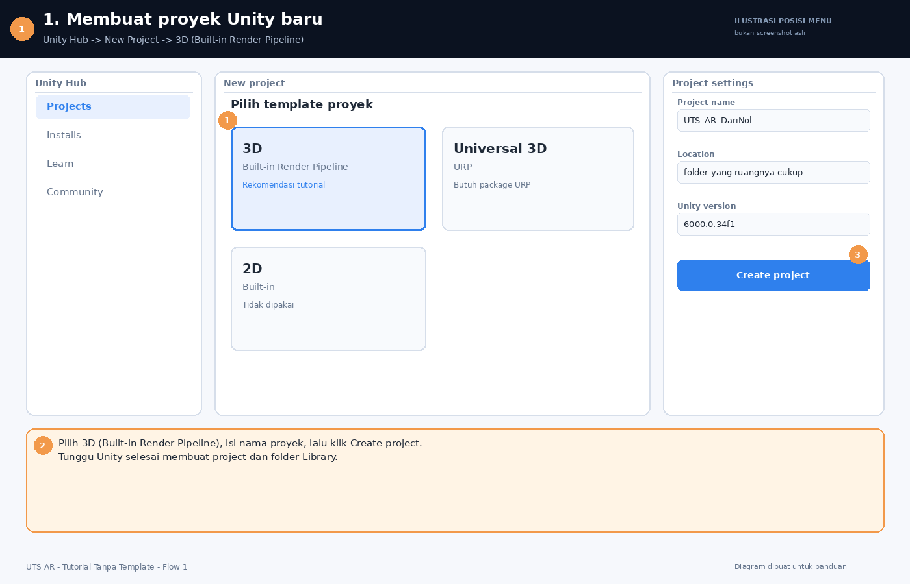

*Gambar 1. Posisi template 3D (Built-in) dan tombol Create project di Unity Hub (ilustrasi).*

### 3.2 Buat folder kerja

Di Project window, buat folder berikut di dalam `Assets`:

```text
Assets/
├── Models/
├── Resources/
├── Scenes/
├── Scripts/
└── StreamingAssets/
    └── Vuforia/
```

Cara membuat: klik kanan `Assets` > **Create > Folder**.

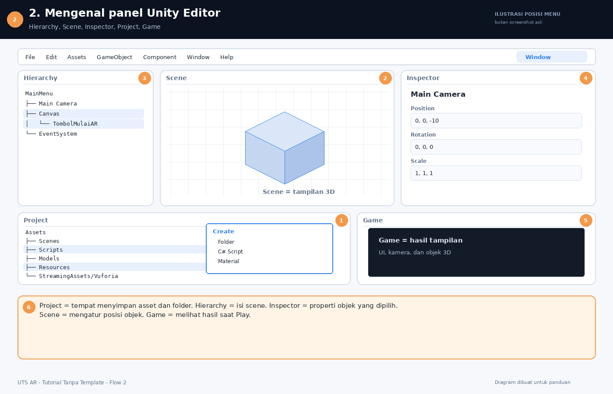

*Gambar 2. Letak panel Hierarchy, Scene, Inspector, Project, dan Game di Unity Editor (ilustrasi).*

### 3.3 Pasang paket Vuforia

Pilihan 1 — melalui Package Manager:

1. Buka **Window > Package Manager**.
2. Klik tombol **+** di kiri atas.
3. Pilih **Add package from tarball...**.
4. Pilih file:

```text
DataRafi_new/Packages/com.ptc.vuforia.engine-11.4.4.tgz
```

atau:

```text
UTS_AR_Template/Packages/com.ptc.vuforia.engine-11.4.4.tgz
```

5. Tunggu proses import selesai.
6. Pastikan menu **GameObject > Vuforia Engine** muncul.

Pilihan 2 — melalui manifest:

1. Salin file `com.ptc.vuforia.engine-11.4.4.tgz` ke folder `Packages/` proyek baru.
2. Buka `Packages/manifest.json`.
3. Tambahkan:

```json
"com.ptc.vuforia.engine": "file:com.ptc.vuforia.engine-11.4.4.tgz"
```

4. Simpan, lalu kembali ke Unity.
5. Tunggu resolusi paket.

Catatan: jika proyek ini di-clone dari repository, jalankan `git lfs install` dan `git lfs pull` terlebih dahulu. Tanpa itu, file `.tgz` masih berupa pointer LFS dan tidak bisa dipasang.

Jika menu Vuforia tidak muncul:

- Buka Console dan cek error.
- Pastikan tarball tidak rusak.
- Pastikan Unity 6 kompatibel dengan Vuforia 11.4.4.
- Coba restart Unity.

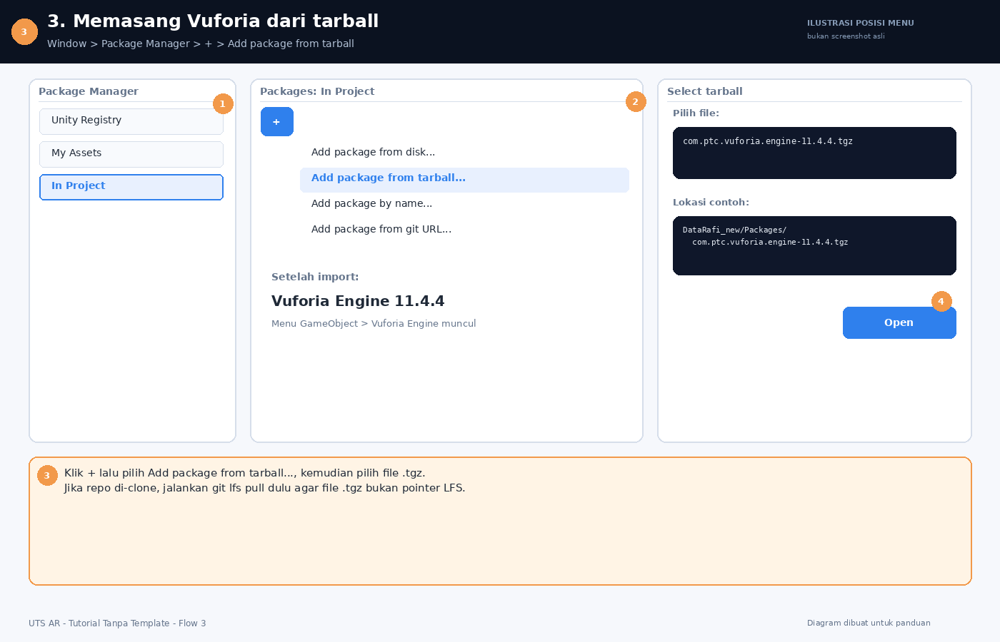

*Gambar 3. Tombol + dan menu Add package from tarball di Package Manager (ilustrasi).*

### 3.4 Siapkan license Vuforia

Pilihan 1 — salin dari proyek lama:

1. Salin `DataRafi_new/Assets/Resources/VuforiaConfiguration.asset` ke `Assets/Resources/` proyek baru.
2. Salin juga file `.meta`-nya jika ada.
3. Tunggu import.

Pilihan 2 — buat konfigurasi baru:

1. Tambahkan **GameObject > Vuforia Engine > AR Camera**.
2. Unity biasanya membuat `Assets/Resources/VuforiaConfiguration.asset`.
3. Pilih file tersebut.
4. Pada Inspector, tempelkan **App License Key** dari dosen.
5. Simpan proyek.

Catatan: di repositori GitHub, file `VuforiaConfiguration.asset` sengaja tidak disimpan karena berisi kunci rahasia. Jika Anda hanya melakukan clone repo, gunakan license key dari dosen pada Pilihan 2.

Jangan mempublikasikan license key.

<details>
<summary><strong>Lihat screenshot Modul 4 halaman 8 — License Manager</strong></summary>

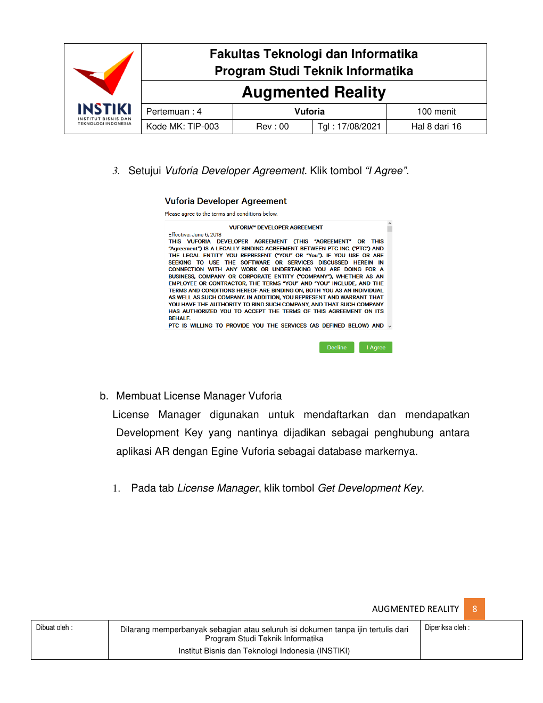

*Sumber: Modul 4 halaman 8. Tampilan Vuforia dapat berbeda dengan versi saat ini; gunakan sebagai petunjuk letak menu.*

</details>

### 3.5 Siapkan database marker

Pilihan 1 — dosen memberi `.dat` dan `.xml`:

1. Salin kedua file ke:

```text
Assets/StreamingAssets/Vuforia/
```

2. Catat nama XML, misalnya `DataRafi.xml`.
3. Catat nama target dari XML, misalnya `cover-sui`.
4. Catat width dan height target.

Pilihan 2 — dosen memberi `.unitypackage`:

1. Buka **Assets > Import Package > Custom Package**.
2. Pilih file dari dosen.
3. Klik **Import**.
4. Database akan masuk ke `Assets/StreamingAssets/Vuforia/` dan prefab Image Target mungkin ikut masuk.

Pilihan 3 — membuat marker sendiri (Modul 4):

1. Buka `https://developer.vuforia.com/`.
2. Register/login.
3. License Manager > **Get Development Key**.
4. Target Manager > **Add Database** > pilih **Device** > **Create**.
5. Buka database > **Add Target** > **Single Image**.
6. Upload gambar marker; isi nama target dan ukuran.
7. Klik **Add Target**.
8. Periksa kualitas target (bintang dan fitur).
9. **Download Database** > **Unity Editor**.
10. Impor `.unitypackage` ke Unity.
11. Tempelkan License Key ke `VuforiaConfiguration`.

Aturan marker yang baik:

- kaya detail;
- kontras terang/gelap bagus;
- tidak ada pola berulang.

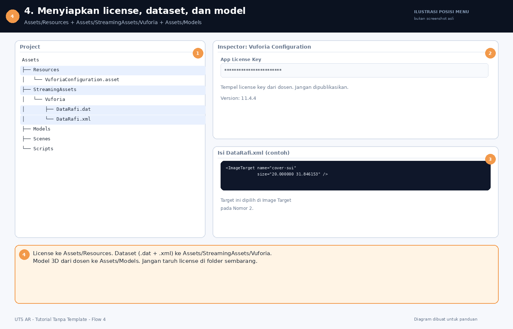

*Gambar 4. Letak license di Assets/Resources, dataset di Assets/StreamingAssets/Vuforia, dan model di Assets/Models (ilustrasi).*

<details>
<summary><strong>Lihat screenshot Modul 4 halaman 12 — Add Target / Single Image</strong></summary>

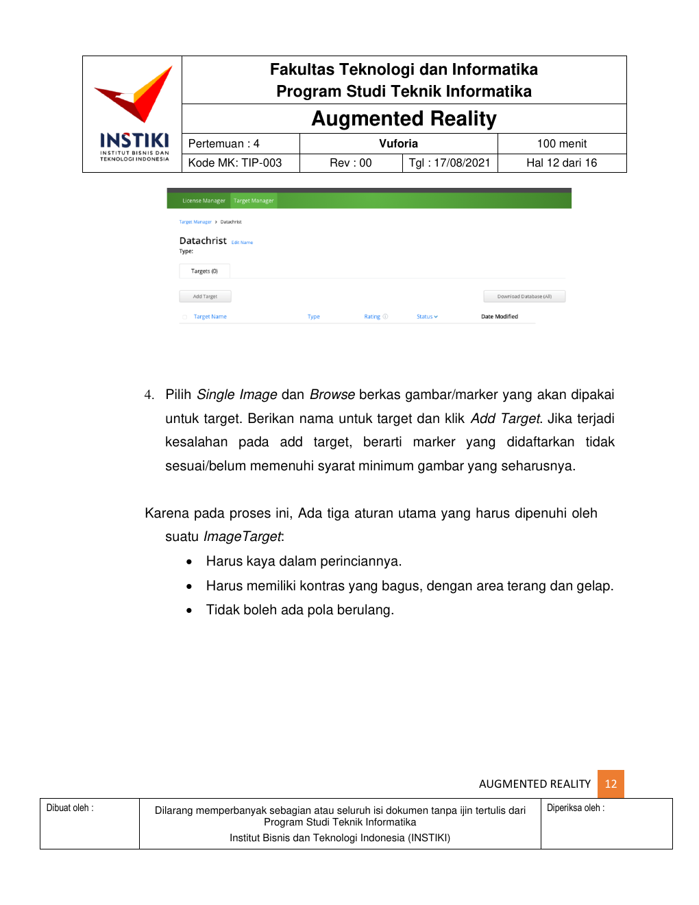

*Sumber: Modul 4 halaman 12. Tampilan Vuforia dapat berbeda; intinya pilih Single Image lalu Add Target.*

</details>

### 3.6 Impor model 3D

1. Impor model dari dosen (FBX/OBJ/GLB) ke `Assets/Models/`.
2. Pastikan tekstur/material ikut masuk.
3. Jika model dari dosen belum ada, gunakan kubus untuk uji awal.

### 3.7 Atur Player Settings awal

1. Buka **Edit > Project Settings > Player**.
2. Isi **Company Name** dan **Product Name**.
3. Untuk Android nanti, isi **Package Name**.
4. Periksa **Active Input Handling**:
   - `Input Manager (Old)` — UI memakai `StandaloneInputModule`.
   - `Input System Package (New)` — UI memakai `InputSystemUIInputModule`.
   - `Both` — paling aman jika memakai Lean Touch versi lama.
5. Simpan.

---

## 4. NOMOR 1 — Menu utama dengan 1 tombol ke AR kamera

**Requirement:** Nilai B no.1 / Nilai A no.1.
**Modul:** Modul 11 (tombol ke scene lain).

**Hasil akhir nomor ini:** scene menu dengan desain dan tombol yang membuka scene AR.

### 4.1 Buat scene menu

1. Buka **File > New Scene**.
2. Pilih **Basic (Built-in)**.
3. Simpan sebagai:

```text
Assets/Scenes/MainMenu.unity
```

4. Pastikan scene memiliki `Main Camera`.

### 4.2 Buat scene AR sementara

Scene AR akan diisi di Nomor 2. Untuk sementara, buat scene kosong agar tombol bisa diuji.

1. **File > New Scene** > **Basic (Built-in)**.
2. Simpan sebagai:

```text
Assets/Scenes/ARScene.unity
```

3. Biarkan kamera default di scene ini untuk sementara. Nanti kamera diganti dengan AR Camera Vuforia.

### 4.3 Daftarkan scene ke Build Settings

1. Buka **File > Build Profiles** (Unity 6) atau **File > Build Settings**.
2. Klik **Add Open Scenes** untuk `MainMenu`.
3. Klik **Add Open Scenes** untuk `ARScene`.
4. Pastikan urutan:

```text
0: Assets/Scenes/MainMenu.unity
1: Assets/Scenes/ARScene.unity
```

### 4.4 Buat Canvas

1. Buka `MainMenu`.
2. Klik kanan Hierarchy > **UI > Canvas**.
3. Pada `Canvas Scaler`:
   - UI Scale Mode: `Scale With Screen Size`
   - Reference Resolution: `1080 x 1920` (portrait) atau `1280 x 720` (landscape)
   - Match: `0.5`
4. Pastikan ada `EventSystem`. Jika tidak ada, klik kanan Hierarchy > **UI > Event System**.
5. Jika memakai Input System baru, pastikan `EventSystem` memakai `InputSystemUIInputModule`. Jika memakai Input Manager lama, gunakan `StandaloneInputModule`.

### 4.5 Desain menu bebas

Buat desain sesuka Anda. Contoh minimal:

1. **Background**
   - Klik kanan Canvas > **UI > Image**.
   - Beri nama `Background`.
   - Pilih warna gelap.
   - Pada Rect Transform, pilih Anchor Presets **stretch** (kiri-kanan-atas-bawah).
2. **Judul**
   - Klik kanan Canvas > **UI > Legacy > Text**.
   - Beri nama `Judul`.
   - Isi `AR UTS`.
   - Atur font size, warna, dan posisi.
3. **Subjudul**
   - **UI > Legacy > Text**.
   - Isi `Marker-Based Augmented Reality`.
4. **Identitas**
   - **UI > Legacy > Text**.
   - Isi nama, NIM, kelas, dan mata kuliah.
5. **Tombol**
   - Klik kanan Canvas > **UI > Button**.
   - Beri nama `TombolMulaiAR`.
   - Ubah teks anaknya menjadi `MULAI AR`.
   - Atur warna, ukuran, dan posisi.

Catatan Unity 6: teks UGUI legacy berada di **UI > Legacy > Text**. TextMeshPro berada di **UI > Text - TextMeshPro** dan tidak kompatibel langsung dengan script yang memakai `UnityEngine.UI.Text`.

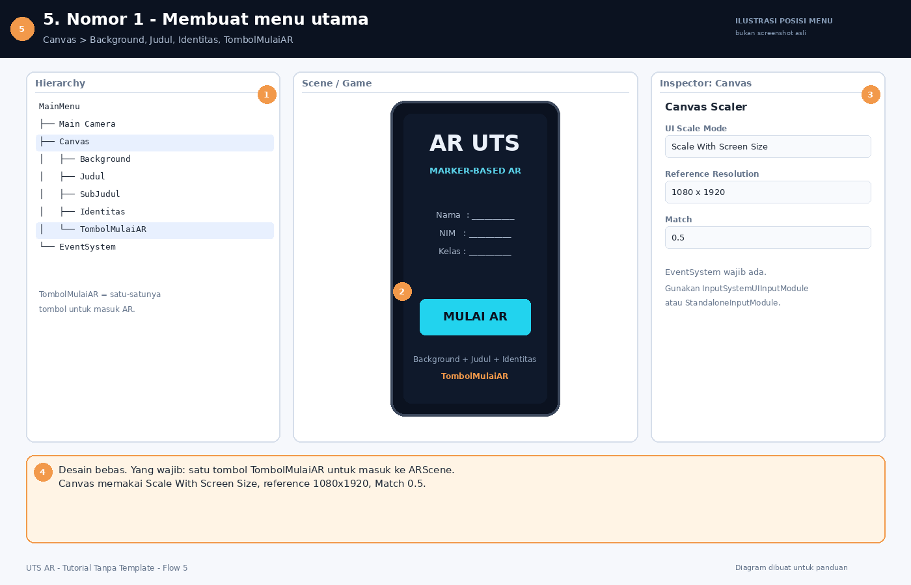

*Gambar 5. Hierarchy dan Canvas menu utama; tombol TombolMulaiAR berada di bawah Canvas (ilustrasi).*

### 4.6 Buat script pindah scene

1. Klik kanan `Assets/Scripts` > **Create > C# Script**.
2. Beri nama `PindahScene`.
3. Buka file dan isi:

```csharp
using UnityEngine;
using UnityEngine.SceneManagement;

public class PindahScene : MonoBehaviour
{
    public void PindahKeScene(string namaScene)
    {
        SceneManager.LoadScene(namaScene);
    }
}
```

4. Simpan script.
5. Tunggu Unity selesai kompilasi.

Penjelasan:

- `SceneManager.LoadScene(namaScene)` membuka scene berdasarkan nama.
- Parameter `string namaScene` memunculkan kolom nama scene di OnClick Button.

### 4.7 Hubungkan tombol

1. Pilih `TombolMulaiAR`.
2. Klik **Add Component**, cari `PindahScene`, lalu tambahkan.
3. Pada komponen `Button`, cari **On Click ()**.
4. Klik **+**.
5. Seret `TombolMulaiAR` ke kolom objek.
6. Pada dropdown fungsi, pilih:

```text
PindahScene > PindahKeScene (string)
```

7. Pada kolom parameter, ketik:

```text
ARScene
```

8. Simpan scene: **File > Save**.

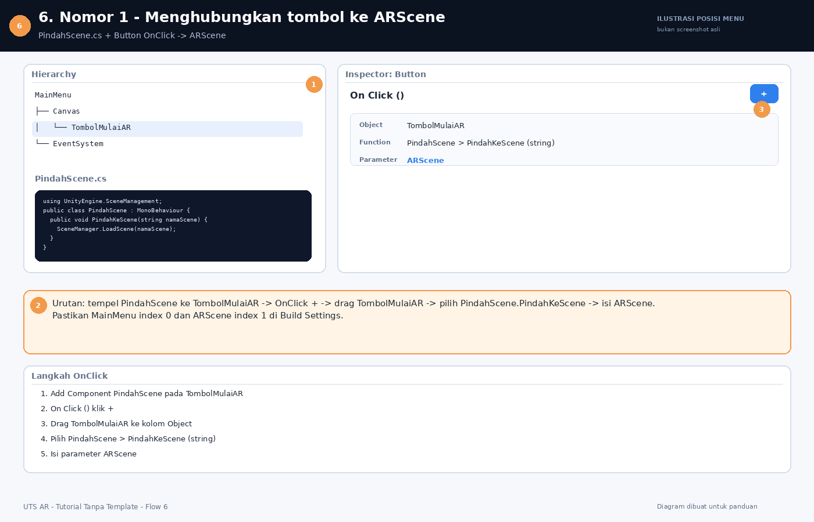

*Gambar 6. Inspector Button: OnClick, fungsi PindahScene, dan parameter ARScene (ilustrasi).*

<details>
<summary><strong>Lihat screenshot Modul 11 — script pindah scene dan OnClick</strong></summary>

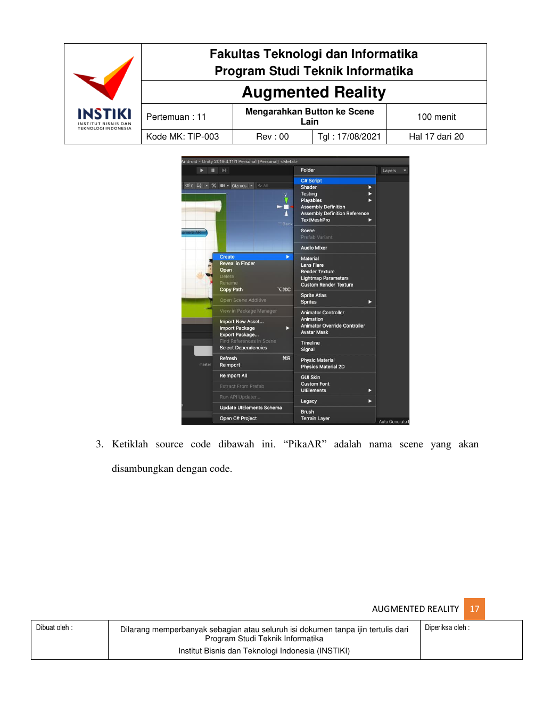

*Modul 11 halaman 17 — membuat script pindah scene.*

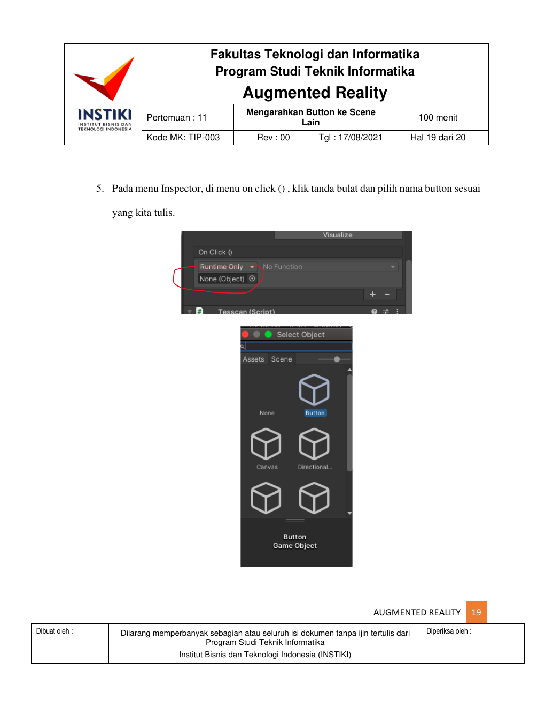

*Modul 11 halaman 19 — mengisi OnClick Button. Modul memakai nama scene `PikaAR`; tutorial ini memakai `ARScene`. Tampilan Unity di modul mungkin versi lebih lama.*

</details>

### 4.8 Uji Nomor 1

1. Tekan Play di scene `MainMenu`.
2. Klik **MULAI AR**.
3. Scene `ARScene` akan terbuka (masih kosong).
4. Tekan Play lagi untuk berhenti.
5. Jika tombol tidak bereaksi:
   - pastikan OnClick sudah diisi;
   - pastikan `ARScene` ada di Build Settings;
   - pastikan `EventSystem` ada;
   - pastikan tidak ada error kompilasi.

### 4.9 Checklist Nomor 1

- [ ] `MainMenu.unity` ada.
- [ ] Canvas dan EventSystem ada.
- [ ] Background, judul, dan identitas ada.
- [ ] Tombol `MULAI AR` ada.
- [ ] Script `PindahScene` terpasang.
- [ ] OnClick mengarah ke `PindahScene.PindahKeScene` dengan parameter `ARScene`.
- [ ] `MainMenu` dan `ARScene` ada di Build Settings.
- [ ] Tombol berhasil membuka `ARScene`.

---

## 5. NOMOR 2 — AR kamera menampilkan objek 3D

**Requirement:** Nilai B no.2 / Nilai A no.2.
**Modul:** Modul 4 (marker/license/database) dan Modul 5 (objek 3D, material).

**Hasil akhir nomor ini:** saat marker dipindai, model 3D muncul di atas marker.

### 5.1 Ganti kamera di ARScene

1. Buka `Assets/Scenes/ARScene.unity`.
2. Hapus `Main Camera` bawaan (atau nonaktifkan) agar tidak ada dua AudioListener.
3. Tambahkan AR Camera:
   - **GameObject > Vuforia Engine > AR Camera**.
4. Pastikan `ARCamera` memiliki:
   - `Camera`
   - `AudioListener`
   - `Vuforia Behaviour`
   - `Default Initialization Error Handler`

### 5.2 Tambahkan Image Target

1. **GameObject > Vuforia Engine > Image Target**.
2. Pilih `ImageTarget`.
3. Pada komponen `Image Target Behaviour`:
   - **Database**: pilih database dari dosen (`DataRafi`).
   - **Image Target**: pilih target (`cover-sui` atau nama dari dosen).
   - **Width**: sesuaikan dengan XML/dosen. Untuk dataset contoh `cover-sui`: `20`.
   - **Height**: sesuaikan dengan XML/dosen. Untuk dataset contoh `cover-sui`: `31.846153`.
   - Gambar marker contoh `cover-sui` ada di `DataRafi_new/Assets/Editor/Vuforia/ImageTargetTextures/DataRafi/cover-sui_scaled.jpg`.
4. Atur posisi `ImageTarget`:
   - Position: `(0, 0, 0)`
   - Rotation: `(0, 0, 0)`
   - Scale: `(1, 1, 1)`
5. Pastikan ada `Default Observer Event Handler`. Biasanya Vuforia menambahkannya otomatis. Jika tidak, klik **Add Component** > `Default Observer Event Handler`.

Jika target/database tidak muncul:

- Pastikan file `.dat/.xml` ada di `Assets/StreamingAssets/Vuforia/`.
- Pastikan path dataset di Image Target benar.
- Pastikan license Vuforia valid.
- Restart Unity jika perlu.

### 5.3 Tambahkan objek 3D

#### 5.3.1 Kubus untuk uji cepat

1. Klik kanan `ImageTarget` > **3D Object > Cube**.
2. Beri nama `Konten3D`.
3. Atur:
   - Position: `(0, 4, 0)`
   - Scale: `(8, 8, 8)`
4. Tekan Play dan arahkan marker ke webcam.

Jika kubus muncul, berarti AR Camera, marker, dan parenting sudah benar.

#### 5.3.2 Model dari dosen

1. Impor model FBX/OBJ/GLB ke `Assets/Models/`.
2. Hapus kubus `Konten3D` lama.
3. Klik kanan `ImageTarget` > **Create Empty**.
4. Beri nama `Konten3D`.
5. Seret model dari Project ke dalam `Konten3D`.
6. Atur `Konten3D`:
   - Position: `(0, 0, 0)` dulu.
   - Rotation: `(0, 0, 0)` dulu.
   - Scale: `(1, 1, 1)` dulu.
7. Sesuaikan skala model pada **child model**, bukan pada wrapper `Konten3D`. Biarkan wrapper `Konten3D` tetap `Scale (1, 1, 1)` agar slider scale di Nomor 3 bekerja benar. Target contoh berukuran 20 unit x 31,8 unit; model dengan tinggi 10–15 unit biasanya proporsional.
8. Jika model tidur/miring:
   - Z-up: `Rotation X = -90`.
   - Y-up: tidak perlu rotasi.
9. Letakkan koreksi rotasi/posisi pada model anak, bukan pada wrapper `Konten3D`, agar slider rotasi di Nomor 3 tetap bersih.

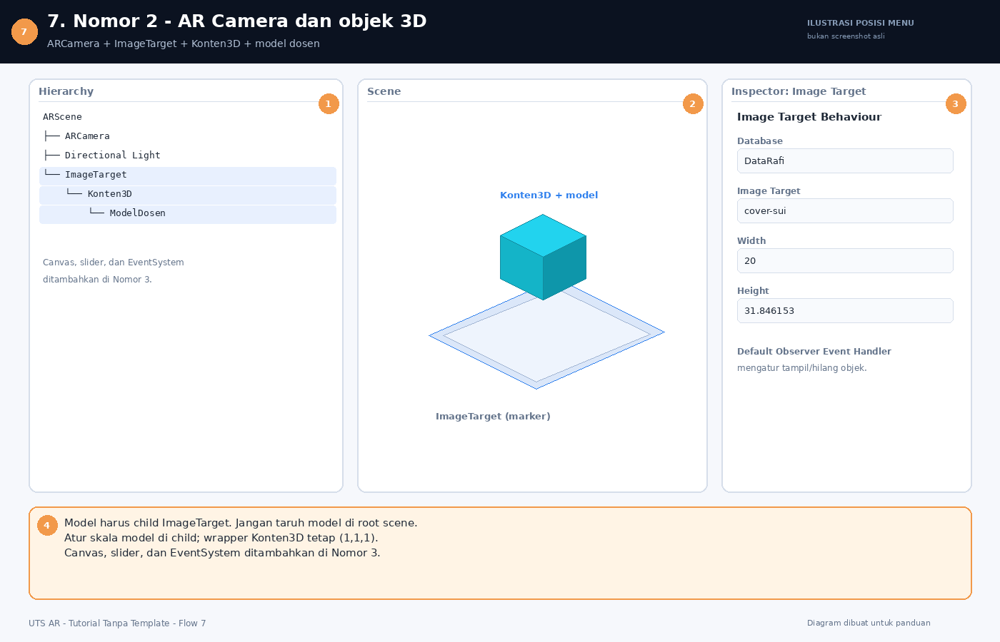

*Gambar 7. Hierarchy AR: ImageTarget > Konten3D > model dosen, beserta panel Inspector Image Target (ilustrasi).*

<details>
<summary><strong>Lihat screenshot Modul 5 halaman 10 — menambahkan objek 3D</strong></summary>

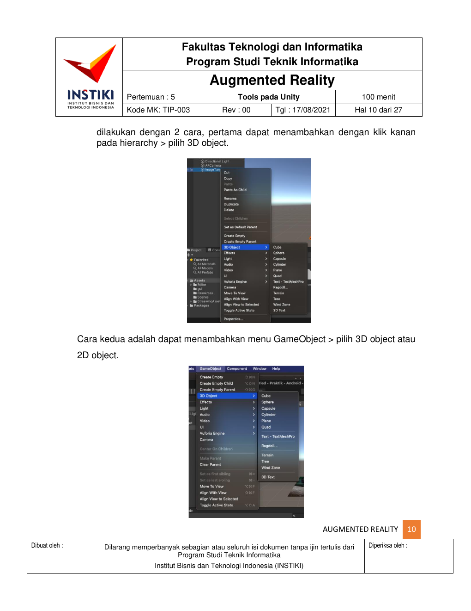

*Sumber: Modul 5 halaman 10. Tampilan Unity di modul mungkin versi lebih lama.*

</details>

### 5.4 Material dan tekstur

1. Klik kanan Project > **Create > Material**.
2. Beri nama `MaterialKonten`.
3. Pada Inspector, cari **Albedo**.
4. Seret tekstur ke kotak Albedo.
5. Seret material ke objek 3D.
6. Jika pink:
   - Built-in: shader `Standard`.
   - URP: shader `Universal Render Pipeline/Lit`.

<details>
<summary><strong>Lihat screenshot Modul 5 halaman 15 — material dan tekstur</strong></summary>

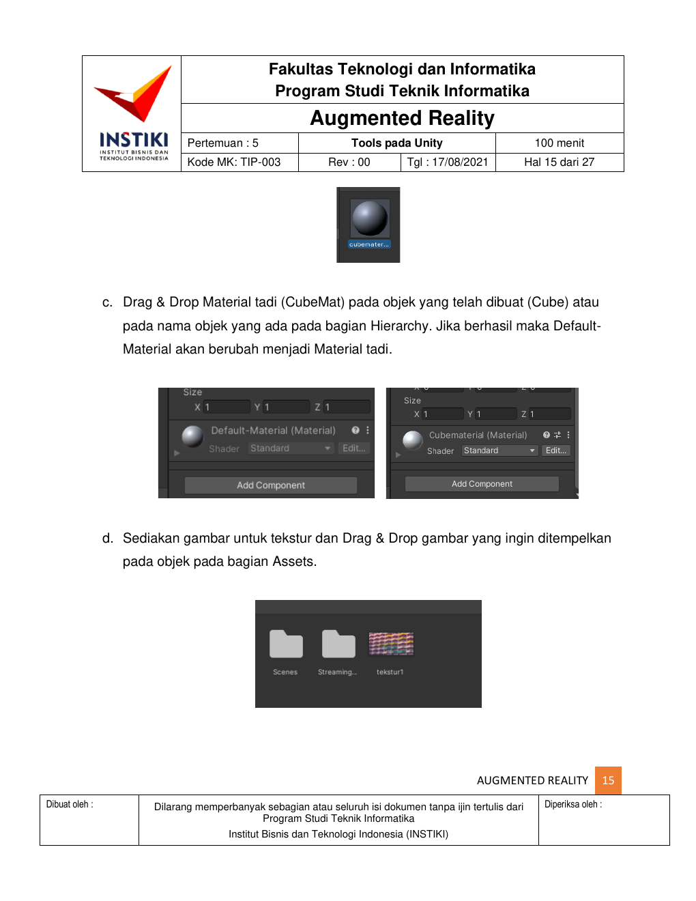

*Sumber: Modul 5 halaman 15. Tampilan Unity di modul mungkin versi lebih lama; intinya material ditempel ke objek dan tekstur masuk ke Albedo.*

</details>

### 5.5 Uji Nomor 2

1. Simpan `ARScene`.
2. Cetak marker dari dosen atau tampilkan di layar lain.
3. Tekan Play.
4. Arahkan marker ke webcam.
5. Objek 3D harus muncul di atas marker.
6. Jika tidak muncul:
   - pastikan objek adalah child `ImageTarget`;
   - pastikan skala tidak terlalu kecil;
   - pastikan marker terdeteksi di Console Vuforia;
   - pastikan dataset/target benar;
   - pastikan license valid.

Catatan: Vuforia di Editor membutuhkan webcam. Jika tidak ada webcam, build ke HP Android.

### 5.6 Uji dari menu

1. Buka `MainMenu`.
2. Tekan Play.
3. Klik **MULAI AR**.
4. Scene `ARScene` terbuka.
5. Arahkan marker.
6. Objek 3D muncul.

Jika dari menu tidak muncul tetapi Play langsung di `ARScene` berhasil, periksa:
- `ARScene` sudah tersimpan;
- `ARScene` ada di Build Settings;
- tidak ada duplicate AudioListener;
- license/dataset tetap ada.

### 5.7 Checklist Nomor 2

- [ ] `ARCamera` Vuforia ada.
- [ ] `ImageTarget` ada dan memakai database/target yang benar.
- [ ] Objek 3D adalah child `ImageTarget`.
- [ ] Model dari dosen sudah dipasang.
- [ ] Material/tekstur benar.
- [ ] Marker terdeteksi.
- [ ] Objek muncul saat marker dipindai.
- [ ] Objek muncul saat masuk dari menu.

---

## 6. NOMOR 3 — Zoom atau rotasi

**Requirement:** Nilai A no.3.
**Modul:** Modul 6 (Lean Touch dan slider).

**Hasil akhir nomor ini:** objek 3D dapat diputar dan/atau diperbesar.

Pilih salah satu:

- **Cara A**: slider rotasi + slider scale (paling mudah, tanpa paket tambahan).
- **Cara B**: Lean Touch untuk pinch/rotate/drag (sesuai Modul 6).

Cara A sudah cukup untuk memenuhi syarat “salah satu zoom/rotasi”. Cara B bisa menjadi nilai tambah.

### 6.1 Buat Canvas di ARScene

1. Buka `ARScene`.
2. Klik kanan Hierarchy > **UI > Canvas**.
3. Pada `Canvas Scaler`:
   - UI Scale Mode: `Scale With Screen Size`
   - Reference Resolution: `1280 x 720` atau `1080 x 1920`
   - Match: `0.5`
4. Pastikan ada `EventSystem`.

### 6.2 Slider rotasi

1. Klik kanan Canvas > **UI > Slider**.
2. Rename menjadi `rotateSlider`.
3. Pada komponen `Slider`:
   - Min Value: `0`
   - Max Value: `360`
   - Value: `0`
4. Atur posisi dan ukuran slider.

### 6.3 Slider scale

1. Klik kanan Canvas > **UI > Slider**.
2. Rename menjadi `scaleSlider`.
3. Pada komponen `Slider`:
   - Min Value: `0.5`
   - Max Value: `3`
   - Value: `1`
4. Atur posisi dan ukuran slider.

Jangan memakai Min Value `0` karena objek akan menghilang.

### 6.4 Label slider (opsional)

1. Klik kanan Canvas > **UI > Legacy > Text**.
2. Isi `ROTASI`.
3. Duplikat untuk `ZOOM`.
4. Atur posisi di dekat slider.

### 6.5 Script rotasi

1. Klik kanan `Assets/Scripts` > **Create > C# Script**.
2. Beri nama `rotasi`.
3. Isi:

```csharp
using UnityEngine;
using UnityEngine.UI;

public class rotasi : MonoBehaviour
{
    private Slider rotateSlider;
    public float rotMinValue = 0f;
    public float rotMaxValue = 360f;
    private Quaternion baseRotation;

    void Start()
    {
        baseRotation = transform.localRotation;

        rotateSlider = GameObject.Find("rotateSlider").GetComponent<Slider>();
        rotateSlider.minValue = rotMinValue;
        rotateSlider.maxValue = rotMaxValue;
        rotateSlider.SetValueWithoutNotify(0f);
        transform.localRotation = baseRotation;
        rotateSlider.onValueChanged.AddListener(RotateSliderUpdate);
    }

    void RotateSliderUpdate(float value)
    {
        transform.localRotation = baseRotation * Quaternion.Euler(0f, value, 0f);
    }
}
```

4. Simpan.

Catatan penting:

- Kode asli Modul 6 memakai `transform.rotation.x` dan `transform.rotation.z`. Itu komponen quaternion, bukan sudut Euler. Hasilnya rotasi bisa aneh.
- Kode di atas memakai rotasi offset `baseRotation * Quaternion.Euler(...)`, sehingga orientasi awal model tetap.
- Jika ingin memutar sumbu lain, ganti `Quaternion.Euler(0f, value, 0f)` menjadi sumbu X atau Z.

### 6.6 Script scale

1. Klik kanan `Assets/Scripts` > **Create > C# Script**.
2. Beri nama `scale`.
3. Isi:

```csharp
using UnityEngine;
using UnityEngine.UI;

public class scale : MonoBehaviour
{
    private Slider scaleSlider;
    public float scaleMinValue = 0.5f;
    public float scaleMaxValue = 3f;

    void Start()
    {
        scaleSlider = GameObject.Find("scaleSlider").GetComponent<Slider>();
        scaleSlider.minValue = scaleMinValue;
        scaleSlider.maxValue = scaleMaxValue;
        scaleSlider.SetValueWithoutNotify(transform.localScale.x);
        scaleSlider.onValueChanged.AddListener(ScaleSliderUpdate);
    }

    void ScaleSliderUpdate(float value)
    {
        transform.localScale = new Vector3(value, value, value);
    }
}
```

4. Simpan.

### 6.7 Pasang script ke objek

1. Pilih `Konten3D` (wrapper model).
2. Klik **Add Component** > `rotasi`.
3. Klik **Add Component** > `scale`.
4. Pada `rotasi`:
   - Rot Min Value: `0`
   - Rot Max Value: `360`
5. Pada `scale`:
   - Scale Min Value: `0.5`
   - Scale Max Value: `3`

Jika skala model asli sudah besar (misalnya 10x), letakkan model di dalam wrapper `Konten3D` dengan skala 1, lalu atur skala model di child. Dengan begitu, slider scale mengubah wrapper, bukan merusak skala internal model. Pastikan kedua slider aktif dan namanya tepat, karena `GameObject.Find` tidak menemukan objek yang nonaktif.

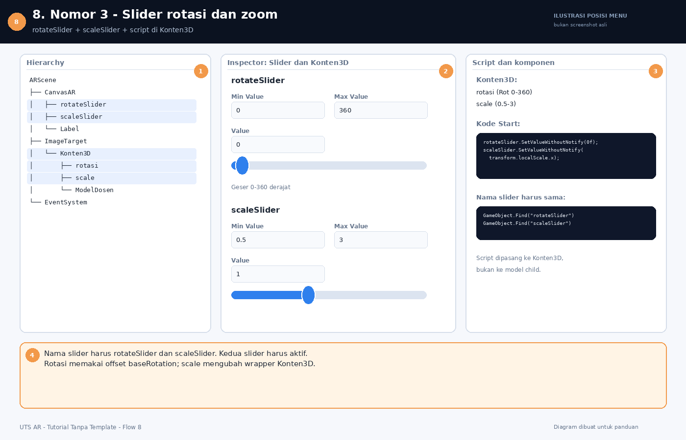

*Gambar 8. Slider rotateSlider/scaleSlider dan komponen rotasi/scale pada Konten3D (ilustrasi).*

<details>
<summary><strong>Lihat screenshot Modul 6 — slider rotasi dan slider scale</strong></summary>

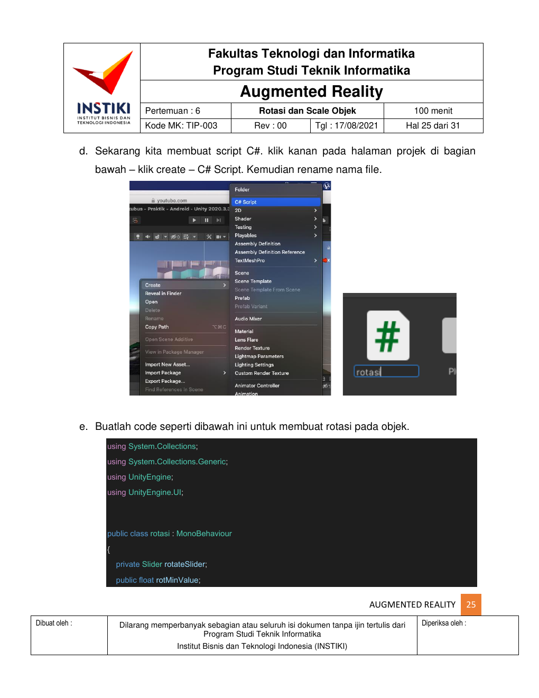

*Modul 6 halaman 25 — slider dan script rotasi.*

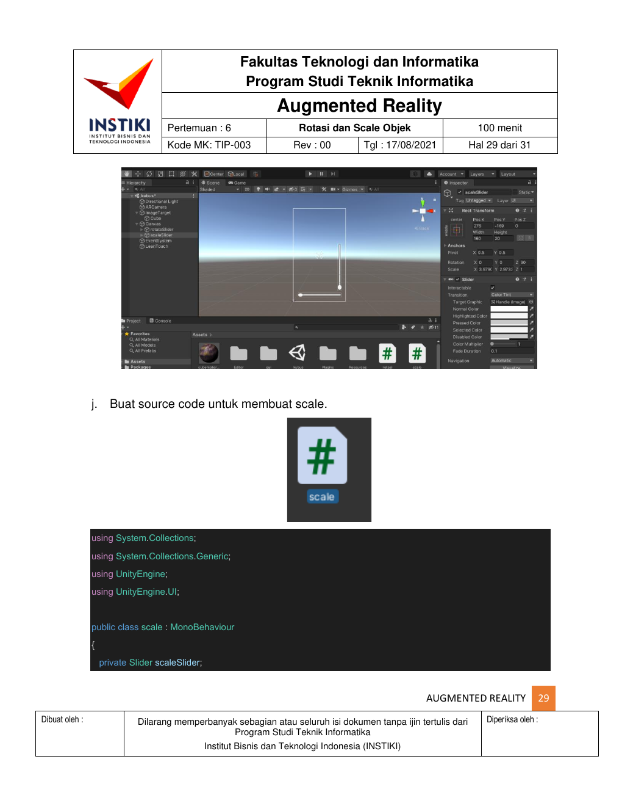

*Modul 6 halaman 29 — slider dan script scale. Tampilan Unity di modul mungkin versi lebih lama. Catatan: kode rotasi di modul memakai `transform.rotation.x`; gunakan kode yang sudah diperbaiki di tutorial ini.*

</details>

### 6.8 Uji Nomor 3

1. Simpan `ARScene`.
2. Tekan Play dari `MainMenu`.
3. Klik **MULAI AR**.
4. Arahkan marker.
5. Geser `rotateSlider`; objek harus berputar.
6. Geser `scaleSlider`; objek harus membesar/mengecil.
7. Jika tidak berubah:
   - pastikan script terpasang pada `Konten3D`;
   - pastikan nama slider tepat `rotateSlider` dan `scaleSlider`;
   - pastikan slider aktif;
   - cek Console untuk `NullReferenceException`;
   - pastikan EventSystem memakai input module yang sesuai.

### 6.9 Opsional — Lean Touch (Modul 6)

Jika ingin pinch/rotate memakai dua jari:

1. Impor Lean Touch:
   - **Window > Package Manager > My Assets** > cari **Lean Touch** > Import; atau
   - salin `DataRafi_new/Assets/Plugins/CW` ke `Assets/Plugins/CW`.
2. Klik kanan Hierarchy > **Lean > Touch**.
3. Pada `Lean Touch`, klik **Add Simulator**.
4. Pilih `Konten3D`.
5. Tambahkan komponen:
   - `Lean Pinch Scale` untuk zoom;
   - `Lean Twist Rotate Axis` untuk rotasi;
   - `Lean Drag Translate` untuk menggeser.
6. Uji di Editor dengan simulator, atau build ke HP dan gunakan dua jari.

Jika Lean Touch versi lama tidak mendeteksi sentuhan, set **Active Input Handling** ke `Both` di Player Settings.

<details>
<summary><strong>Lihat screenshot Modul 6 halaman 21 — komponen Lean Touch</strong></summary>

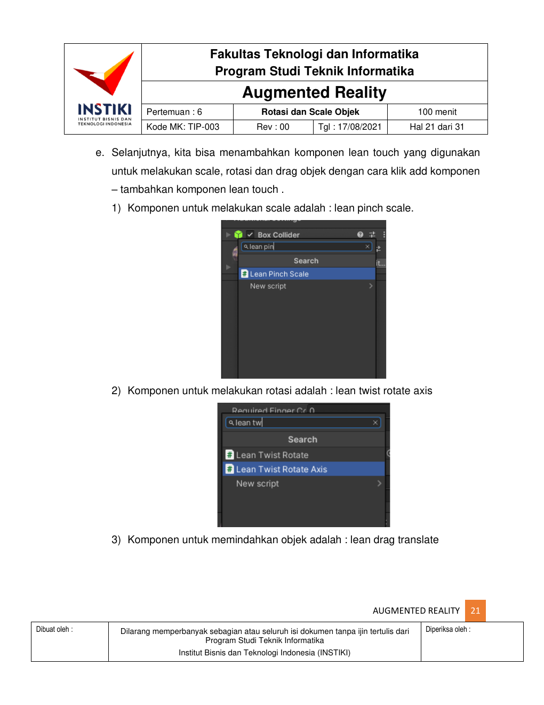

*Sumber: Modul 6 halaman 21. Tampilan Unity di modul mungkin versi lebih lama; komponennya Lean Pinch Scale, Lean Twist Rotate Axis, dan Lean Drag Translate.*

</details>

### 6.10 Checklist Nomor 3

- [ ] Canvas dan EventSystem ada di `ARScene`.
- [ ] `rotateSlider` ada dan Max Value 360.
- [ ] `scaleSlider` ada dan min/max wajar.
- [ ] Script `rotasi` dan `scale` terpasang di `Konten3D`.
- [ ] Rotasi berfungsi.
- [ ] Scale/zoom berfungsi.
- [ ] Tidak ada `NullReferenceException`.
- [ ] Opsional: Lean Touch pinch berfungsi.

---

## 7. Build APK Android

### 7.1 Pasang Android Build Support

1. Buka Unity Hub.
2. Buka **Installs**.
3. Pilih Unity 6.
4. Klik **Add Modules**.
5. Centang:
   - Android Build Support
   - Android SDK & NDK Tools
   - OpenJDK
6. Tunggu instalasi.

### 7.2 Build Settings

1. Simpan semua scene.
2. Buka **File > Build Profiles** (Unity 6) atau **File > Build Settings**.
3. Pilih **Android**.
4. Klik **Switch Platform**.
5. Pastikan scenes:

```text
0: Assets/Scenes/MainMenu.unity
1: Assets/Scenes/ARScene.unity
```

6. Jika belum, klik **Add Open Scenes**.

### 7.3 Player Settings

Buka **Player Settings**:

1. **Company Name**: isi nama Anda.
2. **Product Name**: `UTS AR`.
3. **Package Name**: misalnya `com.nama.nim.utsar`.
4. **Default Icon**: ganti jika perlu.
5. **Other Settings**:
   - Minimum API Level: Android 7.0 (API 24) atau lebih tinggi.
   - Target API Level: Automatic (highest installed).
   - Scripting Backend: IL2CPP.
   - Target Architectures: ARM64.
   - Active Input Handling: sesuai proyek (New, Old, atau Both).
   - Internet Access: Auto.
   - Camera Usage Description: isi jika diminta.

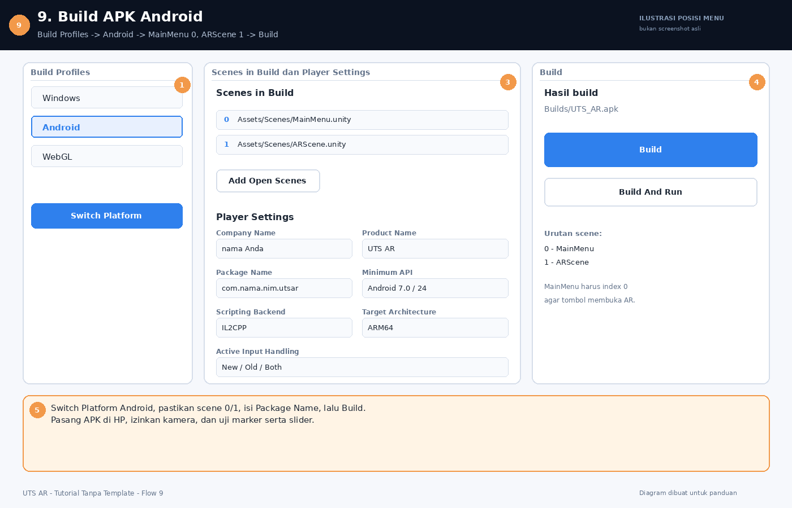

*Gambar 9. Build Profiles: urutan scene MainMenu 0, ARScene 1, Player Settings, dan tombol Build (ilustrasi).*

<details>
<summary><strong>Lihat screenshot Modul 5 halaman 24 — Player Settings</strong></summary>

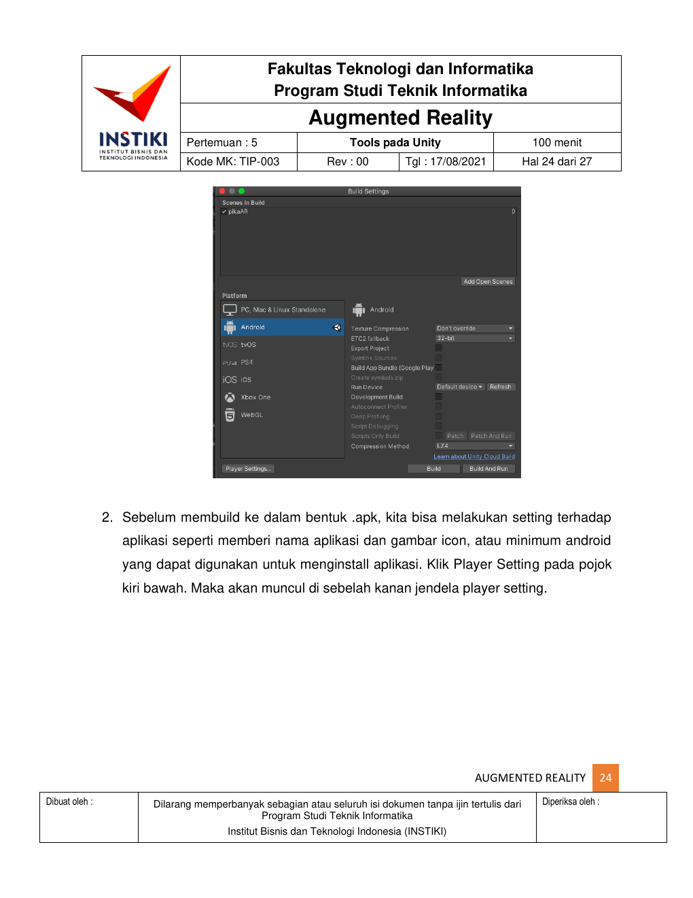

*Sumber: Modul 5 halaman 24. Tampilan Unity di modul mungkin versi lebih lama; di Unity 6 letaknya di Build Profiles / Player Settings.*

</details>

### 7.4 Build

1. Klik **Build** atau **Build and Run**.
2. Simpan APK di luar folder `Assets`, misalnya:

```text
Builds/UTS_AR.apk
```

3. Tunggu build selesai.
4. Pasang APK di HP Android.
5. Buka aplikasi dan izinkan kamera.
6. Uji menu, marker, objek 3D, dan slider zoom/rotasi.

### 7.5 Checklist build

- [ ] Android Build Support terpasang.
- [ ] Kedua scene ada di Build Settings.
- [ ] Package Name terisi.
- [ ] Build berhasil.
- [ ] APK terpasang di HP.
- [ ] Kamera berfungsi.
- [ ] Marker terdeteksi.
- [ ] Zoom/rotasi berfungsi di HP.

---

## 8. Troubleshooting

| Gejala | Kemungkinan penyebab | Solusi |
|---|---|---|
| Menu Vuforia tidak muncul | Paket Vuforia belum terpasang | Pasang tarball melalui Package Manager |
| `Vuforia initialization error` | License salah/tidak ada | Isi `VuforiaConfiguration` dengan key dosen |
| Target tidak muncul di Image Target | Dataset tidak ditemukan | Pastikan `.dat/.xml` ada di `StreamingAssets/Vuforia` |
| Marker tidak terdeteksi | Marker blur, cahaya kurang, target salah | Cetak marker jelas, tambah cahaya, cek target |
| Objek 3D tidak muncul | Bukan child ImageTarget / skala kecil | Parent-kan ke ImageTarget, perbesar skala |
| Objek muncul di Play ARScene tetapi tidak dari menu | Scene belum di Build Settings / duplicate camera | Tambahkan ke Build Settings, hapus kamera lama |
| Tombol menu tidak bereaksi | OnClick kosong | Isi OnClick dengan `PindahScene.PindahKeScene` |
| Tombol tidak bisa diklik | EventSystem hilang / input module salah | Tambahkan EventSystem + modul input yang sesuai |
| `Scene 'ARScene' could not be loaded` | Scene belum ada / belum di Build Settings | Buat scene dan tambahkan ke Build Settings |
| Slider tidak mengubah objek | Script belum terpasang / nama slider beda | Pasang script di objek, samakan nama slider |
| Rotasi aneh | Memakai `transform.rotation.x` | Gunakan `localEulerAngles` atau rotasi offset |
| Objek hilang saat scale | Min Value 0 | Set min 0.5 |
| UI tidak bisa diklik | EventSystem/input module | Gunakan `InputSystemUIInputModule` atau `StandaloneInputModule` |
| Material pink | Shader tidak cocok | Ganti ke `Standard` atau `URP/Lit` |
| `NullReferenceException` | Referensi slider/objek kosong | Cek nama slider dan field di Inspector |
| Build Android gagal | Android module belum ada / package name kosong / disk penuh | Pasang module, isi package, kosongkan disk |
| APK crash | License/package name/arsitektur | Cek logcat, samakan package name, ARM64 |
| Scene AR hitam di Editor | Tidak ada webcam | Build ke HP |
| Lean Touch tidak muncul | Paket belum diimpor | Import Lean Touch / salin `Assets/Plugins/CW` |
| Pinch Lean Touch tidak bekerja | Input handling | Set Active Input Handling ke Both |

---

## 9. Checklist final

### Nilai B

- [ ] Scene `MainMenu` ada dan bisa dibuka.
- [ ] Menu memiliki desain bebas.
- [ ] Ada 1 tombol ke AR kamera.
- [ ] Scene `ARScene` memiliki AR Camera Vuforia.
- [ ] Marker dosen terdeteksi.
- [ ] Objek 3D dosen muncul.

### Nilai A

- [ ] Semua poin Nilai B terpenuhi.
- [ ] Rotasi dan/atau zoom berfungsi.
- [ ] Diuji di Editor dan HP.
- [ ] Build APK berhasil.

### Sebelum dikumpulkan

- [ ] Desain 3D dosen dipakai.
- [ ] Database marker dosen dipakai.
- [ ] License dosen dipasang.
- [ ] Nama/NIM/kelas ada di menu.
- [ ] `MainMenu` dan `ARScene` ada di Build Settings.
- [ ] APK diuji di HP.
- [ ] Backup proyek.
- [ ] License tidak dipublikasikan.

---

## 10. Catatan penting

- Dokumen ini **tidak memakai template** dan **tidak memakai generator** `UTSTemplateBuilder`.
- Proyek baru dibuat dari Unity Hub dengan template 3D Built-in.
- `UTS_AR_Template` hanya menjadi sumber referensi untuk paket Vuforia, license, dan dataset contoh.
- Jika dosen memberi license/dataset/model baru, gunakan aset dosen.
- Jangan mempublikasikan license Vuforia.
- Unity 6000.0.34f1; jangan memakai Unity 2021/2022 untuk panduan ini.
- Sisakan beberapa GB disk untuk `Library` dan build.
- Kode Modul 6 sudah diperbaiki untuk Unity 6 (rotasi memakai `localEulerAngles`/offset).
- Untuk teks/info tambahan, lihat Modul 9 dan bagian 7 pada `README.md` utama.

---

## 11. Referensi modul

- **Modul 4** — Membuat marker, license, dan database Vuforia.
- **Modul 5** — Tools Unity, objek 3D/FBX, material, build APK.
- **Modul 6** — Lean Touch dan slider rotasi/scale.
- **Modul 9** — Teks dan tombol informasi.
- **Modul 11** — Tombol menu ke scene lain.

Tutorial ini disusun end-to-end untuk Nomor 1, 2, dan 3 sesuai requirement UTS pada gambar.
